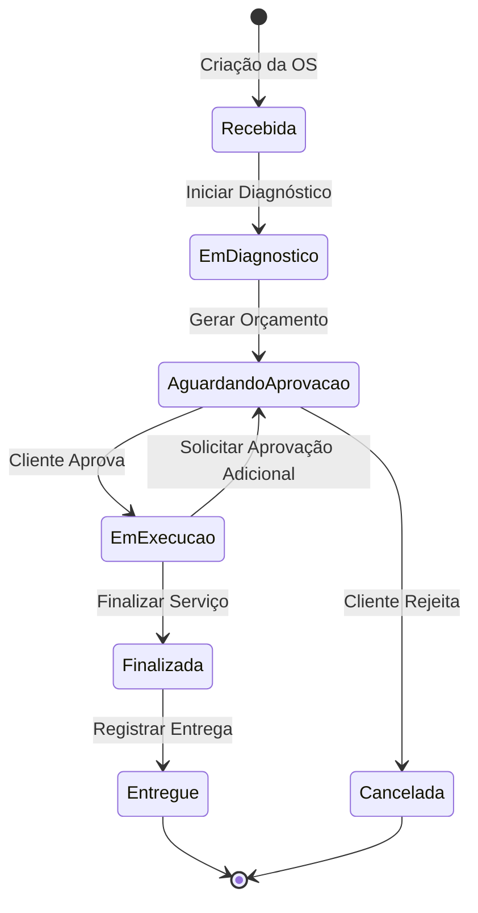
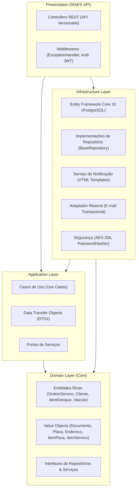

# 🛠️ SIAES — Sistema Integrado de Atendimento e Execução de Serviços


> **FIAP — Pós-Graduação em Software Architecture · Turma 18SOAT**  
> **Tech Challenge — Fase 1**: MVP do back-end para gestão operacional e administrativa de oficinas mecânicas, aplicando **Domain-Driven Design (DDD)**, **Clean Architecture / Ports and Adapters**, segurança (LGPD/JWT) e práticas avançadas de qualidade de software.

---

## 📑 Índice

- [Objetivo do Projeto](#-objetivo-do-projeto)
- [Descrição da Solução](#-descrição-da-solução)
- [Arquitetura](#-arquitetura)
- [Tecnologias Utilizadas](#-tecnologias-utilizadas)
- [Pré-requisitos](#-pré-requisitos)
- [Instruções para Execução](#-instruções-para-execução)
- [Instruções para Execução dos Testes](#-instruções-para-execução-dos-testes)
- [Documentação da API (Swagger & Endpoints)](#-documentação-da-api-swagger--endpoints)
- [Banco de Dados — Decisão e Justificativa (ADR 001)](#-banco-de-dados--decisão-e-justificativa-adr-001)
- [Autenticação e Credenciais de Demonstração](#-autenticação-e-credenciais-de-demonstração)
- [Estrutura do Projeto](#-estrutura-do-projeto)
- [Documentação DDD](#-documentação-ddd)
- [Vídeo da Entrega](#-vídeo-da-entrega)
- [Autores](#-autores)

---

## 🎯 Objetivo do Projeto

O objetivo principal deste projeto é desenvolver a primeira versão (**MVP**) do back-end para o **SIAES** (*Sistema Integrado de Atendimento e Execução de Serviços*), uma plataforma robusta e escalável projetada para modernizar a gestão de oficinas mecânicas.

A solução substitui controles manuais e desorganizados (baseados em blocos de papel e planilhas desconexas) por um sistema centralizado, auditável e seguro, fundamentado nas práticas de **Domain-Driven Design (DDD)** e arquitetura limpa.

### 🛠️ Problemas Resolvidos pela Solução
* **Perda de histórico e erros na triagem**: Falta de rastreabilidade de veículos e clientes, gerando retrabalho e diagnósticos imprecisos.
* **Furos no controle de estoque**: Peças retiradas sem baixa transacional ou duplicidade de uso por falta de controle de reserva.
* **Ineficiência no fluxo de orçamentos**: Morosidade no cálculo de peças e mão de obra, além de autorizações informais de clientes sem registro oficial.
* **Falta de transparência para o cliente**: Dificuldade em acompanhar em tempo real o status de execução e término da manutenção do veículo.

---

## 📝 Descrição da Solução

O **SIAES** orquestra ponta a ponta as rotinas operacionais de uma oficina mecânica, contemplando os seguintes módulos e fluxos de negócio:

### 1. Gestão de Clientes e Veículos (Conformidade LGPD)
* Cadastro completo de clientes com validação de **CPF ou CNPJ** por meio do Objeto de Valor (`Documento`).
* **Proteção de Dados Sensíveis**: Documentos pessoais são protegidos com **criptografia determinística AES-256** no banco de dados, permitindo buscas indexadas sem expor o dado em texto puro, e exibição mascarada nas consultas.
* Cadastro de veículos vinculados ao cliente contendo Placa (com validação Mercosul/legado), Marca, Modelo e Ano.

### 2. Catálogo de Serviços e Controle de Estoque
* **Catálogo de Serviços**: Gestão de serviços padronizados (ex.: Troca de Óleo, Alinhamento, Revisão Geral) com descrição e valor de referência.
* **Estoque Transacional com Reserva**: Controle rígido de saldo físico (`QuantidadeEmEstoque`) e saldo reservado (`QuantidadeReservada`). Ao vincular uma peça a uma OS, o saldo disponível é imediatamente reservado para evitar vendas duplicadas.

### 3. Ciclo de Vida da Ordem de Serviço (OS)
A Ordem de Serviço é a raiz de agregação central do sistema, implementando uma máquina de estados finita estrita:


* **Geração Automática do Orçamento**: O valor total da OS é calculado a partir da soma dos serviços e peças adicionados.
* **Consistência de Estoque Integrada ao Ciclo de Vida**:
  * Ao **adicionar peças** à OS ➔ Reserva o saldo no estoque (`itemEstoque.Reservar()`).
  * Em caso de **rejeição do orçamento** ➔ Libera a reserva no estoque (`itemEstoque.LiberarReserva()`).
  * Na **finalização do serviço** ➔ Efetua a baixa definitiva do estoque físico e da reserva (`itemEstoque.BaixarReserva()`).

### 4. Fluxo de Notificações por E-mail (Integração Resend)
* Notificação automática e assíncrona ao cliente via **Resend** com templates HTML responsivos em todos os momentos críticos do atendimento:
  * **Orçamento Disponível para Aprovação**: E-mail detalhado com tabela discriminada de serviços, peças, valores unitários e valor total da OS, com instruções claras para autorização.
  * **Veículo Recebido**: Confirmação da entrada do veículo na oficina e início da triagem.
  * **Orçamento Aprovado**: Confirmação do início da execução dos serviços pela equipe técnica.
  * **Orçamento Rejeitado / Cancelamento**: Confirmação do cancelamento e liberação do veículo.
  * **Veículo Pronto para Retirada**: Notificação de conclusão dos serviços com horário e local de retirada.
  * **Veículo Entregue**: Confirmação de encerramento do atendimento e agradecimento.
* **Resiliência**: Falhas de comunicação com a API de mensageria externa são tratadas com *graceful fallback* e log de advertência, não comprometendo as transações de banco de dados.

### 5. Consulta Pública de Status
* Endpoints públicos que permitem ao cliente consultar o status atual da sua OS em tempo real informando o **ID da Ordem de Serviço** ou o **CPF/CNPJ**, garantindo transparência sem exigir credenciais administrativas.

---

## 🏛️ Arquitetura

O projeto adota os padrões **Clean Architecture** e **Ports and Adapters (Hexagonal)**, alinhados aos princípios táticos e estratégicos do **Domain-Driven Design (DDD)**:



### Divisão de Responsabilidades

| Camada | Projeto | Responsabilidades |
| :--- | :--- | :--- |
| **Domain** | `src/Domain` | Núcleo do sistema. Contém entidades ricas com encapsulamento de invariantes (`OrdemServico`, `Cliente`, `ItemEstoque`, `Veiculo`, `Servico`, `User`), Objetos de Valor imutáveis (`Documento`, `Placa`, `Endereco`, `ItemPeca`, `ItemServico`, `RegistroStatus`), exceções de domínio e contratos de repositórios e serviços (`IOrdemServicoRepository`, `IResendEmailService`, `IOrdemServicoNotificationService`). Não possui dependência externa de frameworks. |
| **Application** | `src/Application` | Orquestração dos fluxos de negócio através de **Use Cases** atômicos (ex.: `CreateOrdemServicoUseCase`, `GerarOrcamentoUseCase`, `FinalizarOrdemServicoUseCase`), DTOs de entrada/saída e validações. Não conhece detalhes de banco de dados ou provedores de mensageria. |
| **Infrastructure** | `src/Infrastructure` | Implementações técnicas concretas: contexto do banco de dados (`ApplicationDbContext`), mapeamento fluente do EF Core, migrações, repositórios com `AsSplitQuery()`, serviço de notificação com geração de HTML, cliente do **Resend**, criptografia determinística AES-256 e seeders. |
| **Presentation** | `src/SIAES.API` | Ponto de entrada HTTP RESTful. Configuração da injeção de dependência (IoC), versionamento de API (`v1.0`), autenticação JWT com rotação de tokens, documentação interativa via **Swagger/OpenAPI** e tratamento global de exceções. |

---

## 🚀 Tecnologias Utilizadas

- **Plataforma & Linguagem**: [.NET 10](https://dotnet.microsoft.com/) / C# 14
- **Framework Web**: [ASP.NET Core Web API](https://learn.microsoft.com/aspnet/core/)
- **ORM & Persistência**: [Entity Framework Core 10](https://learn.microsoft.com/ef/core/) com [Npgsql.EntityFrameworkCore.PostgreSQL](https://www.npgsql.org/efcore/)
- **Banco de Dados Relacional**: [PostgreSQL 16-alpine](https://www.postgresql.org/)
- **Envio de E-mails Transacionais**: [Resend .NET SDK](https://resend.com/)
- **Segurança & Criptografia**:
  - [BCrypt.Net-Next](https://github.com/BcryptNet/bcrypt.net) para hash e salt seguro de senhas
  - `System.Security.Cryptography` com **AES-256** (Criptografia determinística para documentos e CBC para dados sensíveis)
  - Autenticação e Autorização via **JWT (JSON Web Token)** com Refresh Token rotation
- **Conteinerização**: [Docker](https://www.docker.com/) e [Docker Compose](https://docs.docker.com/compose/)
- **Documentação da API**: [Swagger / Swashbuckle](https://swagger.io/) com suporte a OpenAPI e Versionamento
- **Testes Automatizados**:
  - [xUnit](https://xunit.net/) — Framework de testes
  - [NSubstitute](https://nsubstitute.github.io/) — Biblioteca para mocks e stubs
  - [Coverlet](https://github.com/coverlet-coverage/coverlet) — Coleta de cobertura de código
- **Qualidade & CI/CD**:
  - [GitHub Actions](https://github.com/features/actions) — Pipeline automatizado de compilação, testes e build Docker
  - [SonarCloud](https://sonarcloud.io/) — Análise estática de código, detecção de vulnerabilidades e controle de duplicação

---

## ✅ Pré-requisitos

Para executar e testar a aplicação em ambiente local:

- [.NET 10 SDK](https://dotnet.microsoft.com/download/dotnet/10.0)
- [Docker Desktop](https://www.docker.com/products/docker-desktop/) (com Docker Compose ativo)
- [Git](https://git-scm.com/)
- *(Opcional)* Token de API do [Resend](https://resend.com/) caso queira disparar e-mails reais para caixas de entrada externas durante testes manuais (a aplicação já possui fallback seguro e funcional para desenvolvimento local).

---

## ▶️ Instruções para Execução

### 1. Clonar o repositório

```bash
git clone https://github.com/marcoswferreira/18SOAT_TechChallenge.git
cd 18SOAT_TechChallenge
```

### 2. Subir os containers com Docker Compose

```bash
docker-compose up -d --build
```

> ℹ️ **Migrações e Carga Inicial Automáticas:**  
> Na inicialização da API, o Entity Framework Core aplica automaticamente as migrações pendentes no PostgreSQL e efetua o *seed* dos usuários padrão com credenciais de demonstração.

### 3. Acessar a aplicação

- **API Base URL**: `http://localhost:8082`
- **Swagger UI**: `http://localhost:8082/swagger`

---

## 🧪 Instruções para Execução dos Testes

O projeto conta com **331 testes automatizados** cobrindo isoladamente as regras do domínio, os casos de uso da aplicação e as integrações com banco e segurança, mantendo **100% de taxa de sucesso**.

```
Passed! - Failed: 0, Passed: 186, Total: 186 - Domain.UnitTests.dll
Passed! - Failed: 0, Passed: 121, Total: 121 - Application.UnitTests.dll
Passed! - Failed: 0, Passed:  24, Total:  24 - IntegrationTests.dll
Total: 331 testes passando
```

### Executar todos os testes da solução:

```bash
dotnet test SIAES.slnx
```

### Executar por projeto:

```bash
# Testes Unitários de Domínio (Entidades, Value Objects, Validações)
dotnet test tests/Domain.UnitTests

# Testes Unitários de Aplicação (Use Cases, DTOs, Orquestrações)
dotnet test tests/Application.UnitTests

# Testes de Integração (Criptografia, Serviços de Infraestrutura)
dotnet test tests/IntegrationTests
```

---

## 📖 Documentação da API (Swagger & Endpoints)

Com a aplicação rodando, acesse a documentação interativa:
```
http://localhost:8082/swagger
```

### Principais Grupos de Endpoints

| Módulo | Método | Rota | Descrição |
| :--- | :--- | :--- | :--- |
| **Auth** | `POST` | `/api/v1/auth/login` | Autenticação com e-mail/senha e emissão de tokens |
| | `POST` | `/api/v1/auth/refresh-token` | Rotação e renovação do Access Token |
| | `POST` | `/api/v1/auth/revoke-token` | Revogação de Refresh Token ativo |
| **Ordens de Serviço** | `GET` | `/api/v1/ordens-servico/{id}/status` | **Consulta pública** do status da OS por ID |
| | `GET` | `/api/v1/ordens-servico/documento/{doc}/status`| **Consulta pública** das OS de um cliente por CPF/CNPJ |
| | `POST` | `/api/v1/ordens-servico` | Criação de uma nova OS (Status inicial: `Recebida`) |
| | `GET` | `/api/v1/ordens-servico/{id}` | Obtenção detalhada da OS com peças, serviços e histórico |
| | `GET` | `/api/v1/ordens-servico` | Listagem paginada de Ordens de Serviço |
| | `POST` | `/api/v1/ordens-servico/{id}/diagnostico` | Início do diagnóstico técnico (`EmDiagnostico`) |
| | `POST` | `/api/v1/ordens-servico/{id}/pecas` | Adiciona peça à OS e **reserva saldo no estoque** |
| | `POST` | `/api/v1/ordens-servico/{id}/servicos` | Adiciona serviço/mão de obra à OS |
| | `POST` | `/api/v1/ordens-servico/{id}/orcamento` | Gera orçamento e **envia e-mail ao cliente** (`AguardandoAprovacao`) |
| | `POST` | `/api/v1/ordens-servico/{id}/aprovar` | Registra aprovação do cliente e inicia execução (`EmExecucao`) |
| | `POST` | `/api/v1/ordens-servico/{id}/rejeitar` | Rejeita orçamento, cancela OS e **libera reservas de estoque** |
| | `POST` | `/api/v1/ordens-servico/{id}/finalizar` | Finaliza serviços, **baixa estoque físico** e notifica cliente |
| | `POST` | `/api/v1/ordens-servico/{id}/entregar` | Registra entrega do veículo e encerra OS (`Entregue`) |
| **Clientes** | `CRUD` | `/api/v1/clientes` | Gestão de clientes com validação e criptografia de documento |
| **Veículos** | `CRUD` | `/api/v1/veiculos` | Gestão de veículos e vínculo com clientes |
| **Estoque** | `CRUD` | `/api/v1/itens-estoque` | Gestão de itens de estoque com entradas e saldo |
| **Serviços** | `CRUD` | `/api/v1/servicos` | Catálogo de tipos de serviço |
| **Usuários** | `CRUD` | `/api/v1/users` | Gestão de usuários do sistema com controle de perfis (Roles) |

---

## 🗄️ Banco de Dados — Decisão e Justificativa (ADR 001)

Para a camada de persistência do **SIAES**, foi adotado o **PostgreSQL 16** integrado ao **Entity Framework Core 10**.

### Resumo da Justificativa Técnica:
* **Garantias ACID e Consistência de Estoque**: Operações de reserva e baixa de peças exigem atomicidade e isolamento para evitar inconsistências sob concorrência.
* **Mapeamento Natural de Agregados do DDD**: O modelo relacional suporta perfeitamente as fronteiras dos agregados (`OrdemServico`, `Cliente`, `ItemEstoque`, `Veiculo`) com integridade referencial estrita e otimização de consultas com `AsSplitQuery()`.
* **Segurança e Extensibilidade**: Suporte a dados semiestruturados via `JSONB` e integração de alta performance com .NET através do driver `Npgsql`.

📄 **Documentação de Arquitetura**: Consulte a [ADR 001 — Seleção do Banco de Dados Relacional](docs/adrs/adr-001-escolha-do-banco-de-dados.md) para análise detalhada de trade-offs.

---

## 🔐 Autenticação e Credenciais de Demonstração

A API utiliza autenticação JWT com controle de acesso baseado em papéis (**Role-Based Access Control - RBAC**).

### Credenciais Pré-cadastradas (Seeded automaticamente):

| Perfil | Usuário / E-mail | Senha | Role | Acesso |
| :--- | :--- | :--- | :--- | :--- |
| **Administrador** | `admin@siaes.com` | `SenhaAdmin1!` | `Admin` | Acesso irrestrito a todas as rotas e cadastros |
| **Atendente** | `atendente@siaes.com` | `SenhaAten1!` | `Operacional` | Abertura de OS, orçamentos, entrega e clientes |
| **Mecânico** | `mecanico@siaes.com` | `SenhaMec1!` | `Mecanico` | Diagnóstico, inclusão de peças/serviços e finalização |
| **Usuário** | `usuario@siaes.com` | `SenhaUsuario1!` | `User` | Acesso básico a consultas |

### Como Autenticar no Swagger:
1. Acesse `http://localhost:8082/swagger`.
2. Execute a requisição `POST /api/v1/auth/login` informando um dos e-mails e senhas acima.
3. Copie o `accessToken` retornado no corpo da resposta.
4. Clique no botão **Authorize** (cadeado no topo direito do Swagger).
5. Digite `<seu_access_token>` e confirme.
6. As requisições aos endpoints protegidos serão autorizadas.

---

## 📁 Estrutura do Projeto

```
├── .github/
│   └── workflows/
│       └── ci.yml                          # Pipeline CI (Build, Tests, SonarCloud, Docker)
├── docs/
│   ├── adrs/
│   │   └── adr-001-escolha-do-banco-de-dados.md # Decisão de Arquitetura (PostgreSQL)
│   ├── ddd/
│   │   ├── architecture.md                 # Arquitetura e padrões técnicos
│   │   ├── domain-storytelling.md          # Narrativas dos fluxos de negócio As-Is
│   │   ├── event-storming.md               # Workshop de eventos de domínio
│   │   └── linguagem-ubiqua.md             # Dicionário de termos ubíquos
│   └── images/                             # Diagramas visuais dos fluxos
├── src/
│   ├── Domain/                             # Núcleo da Aplicação (Core)
│   │   ├── Common/                         # Entidades base, Aggregates e paginação
│   │   ├── Entities/                       # OrdemServico, Cliente, Veiculo, ItemEstoque, etc.
│   │   ├── Enums/                          # StatusOrdemServico, UnidadeMedida, UserRoleType
│   │   ├── Interfaces/                     # Contratos de Repositórios e Serviços (Portas)
│   │   └── ValueObjects/                   # Documento, Placa, Endereco, ItemPeca, ItemServico
│   ├── Application/                        # Orquestração de Negócio
│   │   ├── Dto/                            # DTOs transversais de paginação e erro
│   │   ├── Extensions/                     # Injeção de dependência dos Use Cases
│   │   └── UseCases/                       # Casos de Uso organizados por domínio
│   │       ├── Auth/                       # Login, Refresh e Revogação de tokens
│   │       ├── Clientes/                   # CRUD de Clientes
│   │       ├── ItensEstoque/               # Gestão de Estoque e Entradas
│   │       ├── OrdensServico/              # Ciclo de vida completo da OS e consultas
│   │       ├── Servicos/                   # Catálogo de Serviços
│   │       ├── Users/                      # Gestão de Usuários
│   │       └── Veiculos/                   # CRUD de Veículos
│   ├── Infrastructure/                     # Adaptadores de Entrada/Saída
│   │   ├── Database/                       # DbContext, Migrations e Repositories
│   │   ├── Extensions/                     # Configuração de Infraestrutura e Resend
│   │   ├── Security/                       # Criptografia AES-256, Hash de senha e UserContext
│   │   ├── Services/                       # ResendEmailService e OrdemServicoNotificationService
│   │   └── Settings/                       # Modelos de configuração fortemente tipados
│   └── SIAES.API/                          # Camada de Apresentação
│       ├── Controllers/                    # Controllers RESTful com versionamento
│       ├── Extensions/                     # Configurações de API, Swagger e CORS
│       └── Program.cs                      # Bootstrapping e configuração do pipeline HTTP
├── tests/
│   ├── Domain.UnitTests/                   # 186 testes de regras e invariantes de domínio
│   ├── Application.UnitTests/              # 121 testes unitários dos Casos de Uso
│   └── IntegrationTests/                   # 24 testes de infraestrutura, criptografia e notificações
├── docker-compose.yml                      # Orquestração local de containers (API + PostgreSQL)
├── SIAES.slnx                              # Arquivo de solução moderno .NET
└── README.md                               # Documentação principal do projeto
```

---

## 📐 Documentação DDD

A documentação detalhada de **Domain-Driven Design** desenvolvida pelo grupo encontra-se em [`docs/ddd/`](docs/ddd/):

| Documento | Descrição |
| :--- | :--- |
| **[Linguagem Ubíqua](docs/ddd/linguagem-ubiqua.md)** | Vocabulário padronizado compartilhado entre especialistas de negócio e desenvolvedores |
| **[Domain Storytelling](docs/ddd/domain-storytelling.md)** | Narrativas e diagramas dos fluxos operacionais da oficina (*Cenários 1, 2 e 3*) |
| **[Event Storming](docs/ddd/event-storming.md)** | Mapeamento de eventos de domínio, comandos e reações do sistema |
| **[Arquitetura](docs/ddd/architecture.md)** | Decisões arquiteturais, camadas e roadmap técnico |
| **[ADR 001 — Banco de Dados](docs/adrs/adr-001-escolha-do-banco-de-dados.md)** | Análise comparativa e justificativa da escolha do PostgreSQL |

---

## 🎬 Vídeo da Entrega

O vídeo demonstrativo com a explicação da arquitetura, fluxo de execução, testes automatizados e funcionamento prático do MVP está disponível no YouTube:

📹 **[Assistir ao vídeo da entrega no YouTube](https://youtube.com/todo)** *(preencher com o link do vídeo final)*

---

## 👥 Autores

| Nome | RM |
| :--- | :--- |
| Alexandre Martins Placido | RMXXXXXX |
| Diego Estefan Conceição de Pádua | RMXXXXXX |
| Jayr Rufino de Almeida Junior | RMXXXXXX |
| Marcos Welington Ferreira | RM378531 |
| Milena Vargas Leonardi | RMXXXXXX |

---

<p align="center">
  <strong>FIAP — Pós-Graduação em Software Architecture</strong><br>
  Tech Challenge · Fase 1 · Turma 18SOAT · 2026
</p>