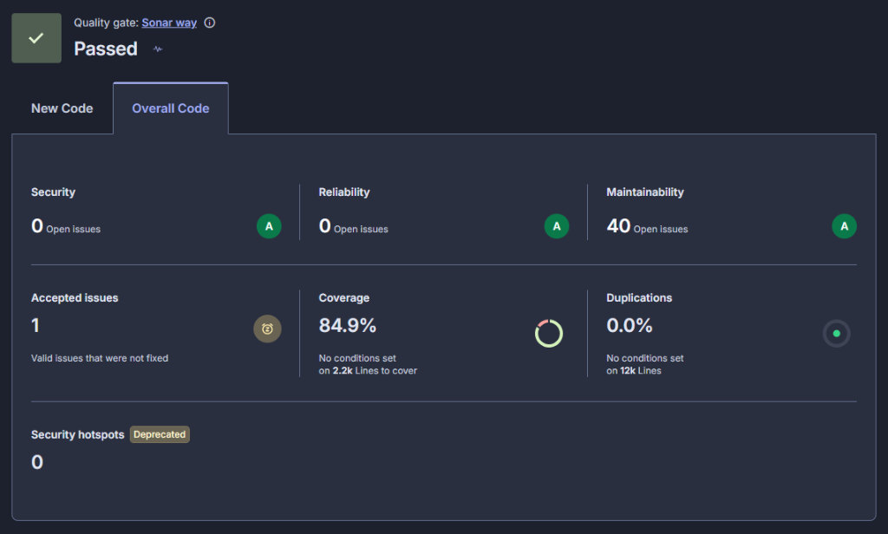

# FIAP — Pós-Graduação em Software Architecture

## Tech Challenge — Fase 1 (Entrega Final)

---

### 1. Identificação da Entrega

| Campo | Informação |
| :--- | :--- |
| **Curso** | SOAT — Software Architecture |
| **Fase** | 1 |
| **Número do Grupo** | Grupo X |
| **Linguagem Principal** | C# 13 (.NET 10 LTS) |
| **Tecnologias Utilizadas** | ASP.NET Core Web API, Entity Framework Core 10, PostgreSQL 16, Docker, Testcontainers, xUnit, NSubstitute, SonarCloud, Resend API |
| **Data de Entrega** | Outubro / 2026 |

<br />

#### Integrantes do Grupo

| Nome Completo | RM | Usuário Discord |
| :--- | :---: | :---: |
| **Alexandre Martins Placido** | *RM378588* | *@arthus.sp* |
| **Diego Estefan Conceição de Pádua** | *RM378740* | *@diego.estefan* |
| **Jayr Rufino de Almeida Junior** | *RM378740* | *@jayrrufino_88046* |
| **Marcos Welington Ferreira** | *RM378531* | *@marcos.wferreira* |
| **Milena Vargas Leonardi** | *RM378633* | *@milenaleonardi* |

<div style="page-break-after: always;"></div>

### 2. Repositório do Projeto

* **Link do Repositório GitHub**: [https://github.com/marcoswferreira/18SOAT_TechChallenge](https://github.com/marcoswferreira/18SOAT_TechChallenge)
* **Status do Repositório**: Público
* **Branch de Entrega**: `main`
* **Commit Hash da Versão Final**: `29d6cfd` (ou versão tag correspondente)
* **Políticas de Proteção de Branch**: A branch `main` é estritamente protegida; todas as alterações foram consolidadas via **Pull Requests revisados**, passando por validação de build, testes automatizados e análise de código no GitHub Actions.

---

### 3. Vídeo da Entrega

* **Link do Vídeo no YouTube**: [https://youtube.com/todo](https://youtube.com/todo) *(Link público com duração máxima de 15 minutos)*
* **Duração**: Menor ou igual a 15 minutos
* **Visibilidade**: Público (sem restrição de acesso ou senha)
* **Conteúdo Demonstrado no Vídeo**:
  1. Apresentação dos integrantes e proposta da solução (SIAES).
  2. Arquitetura em camadas (Clean Architecture + DDD) e justificativa técnica do PostgreSQL (ADR 001).
  3. Apresentação do Event Storming no Miro, Agregados, Entidades e Linguagem Ubíqua.
  4. Execução local via Docker Compose e inicialização da API com seed automático.
  5. Demonstração prática do ciclo de vida completo da Ordem de Serviço (Recebida ➔ Diagnóstico ➔ Peças/Serviços ➔ Orçamento ➔ Aprovação ➔ Finalização com baixa no estoque físico ➔ Entrega do veículo).
  6. Demonstração das consultas públicas por ID da OS e CPF do cliente (sem autenticação).
  7. Fluxo de aprovação adicional e rejeição de orçamento (estorno de estoque).
  8. Envio de notificações por e-mail com layout HTML via Resend.
  9. Execução da suíte de 414 testes automatizados e evidência de cobertura de 100% nas regras de negócio.
  10. Apresentação do relatório de vulnerabilidades e qualidade de código no SonarCloud.

---

### 4. Documentação de Domain-Driven Design (DDD)

* **Boards Oficiais do Event Storming no Miro (Públicos)**:
  * 📋 **Criação e Acompanhamento da Ordem de Serviço**: [https://miro.com/app/board/uXjVHntHpys=/](https://miro.com/app/board/uXjVHntHpys=/)
  * 📦 **Gestão de Peças e Insumos (Estoque)**: [https://miro.com/app/board/uXjVHrbvJdE=/](https://miro.com/app/board/uXjVHrbvJdE=/)
* **Documentação Versionada no Repositório**:
  * Event Storming Completo: [`docs/ddd/event-storming.md`](https://github.com/marcoswferreira/18SOAT_TechChallenge/blob/main/docs/ddd/event-storming.md)
  * Linguagem Ubíqua & Glossário: [`docs/ddd/linguagem-ubiqua.md`](https://github.com/marcoswferreira/18SOAT_TechChallenge/blob/main/docs/ddd/linguagem-ubiqua.md)
  * Domain Storytelling: [`docs/ddd/domain-storytelling.md`](https://github.com/marcoswferreira/18SOAT_TechChallenge/blob/main/docs/ddd/domain-storytelling.md)
  * Arquitetura de Componentes C4: [`docs/architecture/`](https://github.com/marcoswferreira/18SOAT_TechChallenge/tree/main/docs/architecture)

<div style="page-break-after: always;"></div>

### 5. Qualidade de Software, Cobertura de Testes e Evidência SonarCloud

A garantia de qualidade da solução foi validada por testes automatizados em três níveis e inspecionada continuamente pelo **SonarCloud**:

```text
SIAES.slnx (414 testes automatizados — 0 falhas)
├── tests/Domain.UnitTests        (185 testes unitários de entidades, VOs e regras de negócio)
├── tests/Application.UnitTests   (125 testes unitários de casos de uso e DTOs)
└── tests/IntegrationTests        (104 testes de integração com WebApplicationFactory e EF Core)
```

#### Cobertura dos Módulos Críticos de Domínio

| Módulo / Arquivo Crítico | Cobertura de Linhas | Cobertura de Branches | Status |
| :--- | :---: | :---: | :---: |
| `Domain/Entities/OrdemServico.cs` (Ciclo de Vida / FSM) | **100%** | **100%** | Aprovado |
| `Domain/Entities/ItemEstoque.cs` (Controle de Estoque e Reserva) | **100%** | **100%** | Aprovado |
| `Domain/ValueObjects/Documento.cs` (Validação Matemática CPF/CNPJ) | **100%** | **100%** | Aprovado |
| `Domain/ValueObjects/Placa.cs` (Validação de Placas) | **100%** | **100%** | Aprovado |
| `Application/UseCases/OrdensServico/TempoMedioExecucaoUseCase.cs` | **100%** | **100%** | Aprovado |
| `Application/UseCases/OrdensServico/Dto/MetricaTempoExecucaoResponse.cs` | **100%** | **100%** | Aprovado |
| `Application/UseCases/OrdensServico/Dto/TempoMedioExecucaoInput.cs` | **100%** | **100%** | Aprovado |
| `Infrastructure/Database/Repositories/OrdemServicoRepository.cs` | **100%** | **100%** | Aprovado |
| `SIAES.API/Controllers/OrdensServicoController.cs` | **100%** | **100%** | Aprovado |

---

#### 📊 Evidência Oficial do SonarCloud (Branch `main`)

* 🔗 **Painel Oficial**: [https://sonarcloud.io/summary/overall?id=marcoswferreira_18SOAT_TechChallenge&branch=main](https://sonarcloud.io/summary/overall?id=marcoswferreira_18SOAT_TechChallenge&branch=main)
* **Quality Gate**: **Passed** (Sonar way)

| Métrica Inspecionada | Resultado Obtido | Meta do Edital | Status |
| :--- | :---: | :---: | :---: |
| **Quality Gate** | **Passed** | Passed | ✅ Aprovado |
| **Code Coverage (Geral)** | **84.9%** | $\ge 80.0\%$ | ✅ Aprovado |
| **Security Issues** | **0 open issues (Rating A)** | 0 | ✅ Aprovado |
| **Reliability Issues** | **0 open issues (Rating A)** | 0 | ✅ Aprovado |
| **Maintainability** | **Rating A** | Rating A | ✅ Aprovado |
| **Security Hotspots** | **0** | 0 | ✅ Aprovado |
| **Duplications** | **0.0%** | $< 3.0\%$ | ✅ Aprovado |

<div align="center">
  
  <p><em>Figura 1: Evidência do painel SonarCloud na branch main — Quality Gate Passed com 84.9% de cobertura e 0 vulnerabilidades.</em></p>
</div>

<div style="page-break-after: always;"></div>

### 6. Credenciais de Demonstração e Execução Local

O sistema já é inicializado com massa de dados de teste (*Database Seed*) contendo perfis pré-configurados:

| Perfil | E-mail | Senha Padrão | Permissões |
| :--- | :--- | :--- | :--- |
| **Administrador** | `admin@siaes.com` | `SenhaAdmin1!` | Acesso irrestrito a todos os recursos e relatórios |
| **Gerente** | `manager@siaes.com` | `SenhaManager1!` | Gestão operacional e estoques |
| **Atendente** | `atendente@siaes.com` | `SenhaAten1!` | Abertura de OS, cadastro de clientes e orçamentos |
| **Mecânico** | `mecanico@siaes.com` | `SenhaMecanico1!` | Diagnósticos técnicos, inclusão de peças e finalização |
| **Usuário Comum** | `usuario@siaes.com` | `SenhaUsuario1!` | Perfil básico / autocadastro |

#### Como Subir o Ambiente em Menos de 2 Minutos

```bash
# 1. Clonar o repositório
git clone https://github.com/marcoswferreira/18SOAT_TechChallenge.git
cd 18SOAT_TechChallenge

# 2. Subir a aplicação completa e o banco de dados via Docker Compose
docker compose up -d

# 3. Acessar a documentação interativa Swagger
# Abrir no navegador: http://localhost:5180/swagger (ou http://localhost:8080/swagger)
```

#### Execução dos Testes Automatizados

```bash
dotnet test SIAES.slnx --collect:"XPlat Code Coverage;Format=opencover"
```

---

<p align="center">
  <strong>FIAP — Pós-Graduação em Software Architecture</strong><br>
  Tech Challenge · Fase 1 · Turma 18SOAT · 2026
</p>
