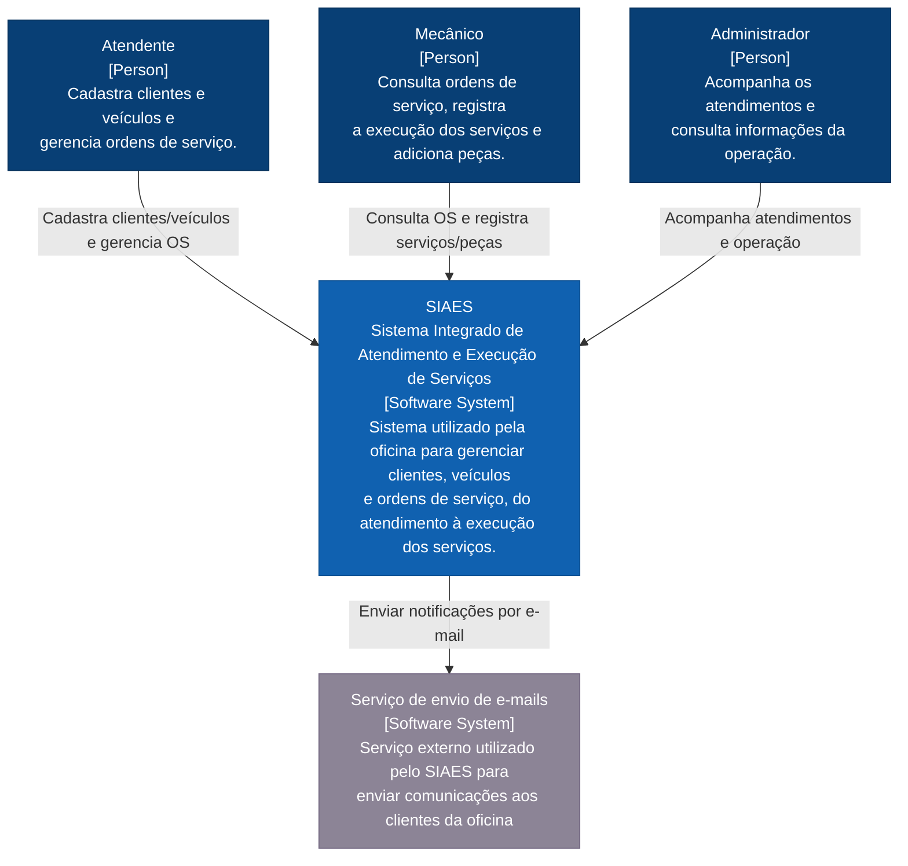

# Diagrama de Contexto do Sistema (C1 do Modelo C4)

Este documento apresenta o **Diagrama de Contexto (C1)** do sistema **SIAES (Sistema Integrado de Atendimento e Execução de Serviços)**, definindo o escopo do sistema de software, seus usuários (atores humanos) e os sistemas externos com os quais interage.

O modelo segue fielmente a especificação definida no arquivo [`C4_ClientesVeiculos_Contexto_C1.drawio`](drawio/C4_ClientesVeiculos_Contexto_C1.drawio).

---

## 1. Visão Geral (Nível C1)

No modelo C4, o diagrama de **Contexto de Sistema (C1)** oferece a visão mais ampla e macro da solução:
- Mostra **quem** utiliza o sistema (personas e papéis operacionais).
- Define a **fronteira** do sistema principal (**SIAES**).
- Mapeia as **integrações externas**, como provedores de mensageria e comunicação.

---

## 2. Diagrama C1 — Contexto do Sistema

---

## 3. Catálogo de Elementos do Contexto

### 3.1. Atores Humanos (Pessoas)

| Elemento | Tipo C4 | Descrição |
| :--- | :--- | :--- |
| **Atendente** | `Person` | Responsável pela recepção presencial ou remota, cadastro de novos clientes, inclusão de veículos no sistema e abertura/gerenciamento inicial das Ordens de Serviço. |
| **Mecânico** | `Person` | Operador técnico da oficina. Consulta ordens de serviço atribuídas, realiza o diagnóstico técnico, requisita/adiciona peças do estoque e registra a execução dos serviços. |
| **Administrador** | `Person` | Gestor da oficina. Acompanha os atendimentos, gerencia usuários e permissões, monitora métricas da operação e supervisiona o ciclo de vida global dos serviços. |

### 3.2. Sistemas de Software

| Elemento | Tipo C4 | Descrição e Tecnologia |
| :--- | :--- | :--- |
| **SIAES** | `Software System` | **Sistema Integrado de Atendimento e Execução de Serviços**: Núcleo central da aplicação que provê regras de negócio, persistência transacional, autenticação RBAC e gestão de clientes, veículos, estoque e ordens de serviço. |
| **Serviço de envio de e-mails** | `Software System` (Externo) | Sistema externo (ex.: Resend / SMTP) utilizado pelo SIAES para envio assíncrono de notificações aos clientes da oficina (aprovação de orçamentos, conclusão de etapas e retirada de veículo). |

---

## 4. Arquivo Draw.io Nativo

O diagrama original editável está disponível em:
- 📁 [`docs/architecture/drawio/C4_ClientesVeiculos_Contexto_C1.drawio`](drawio/C4_ClientesVeiculos_Contexto_C1.drawio)

