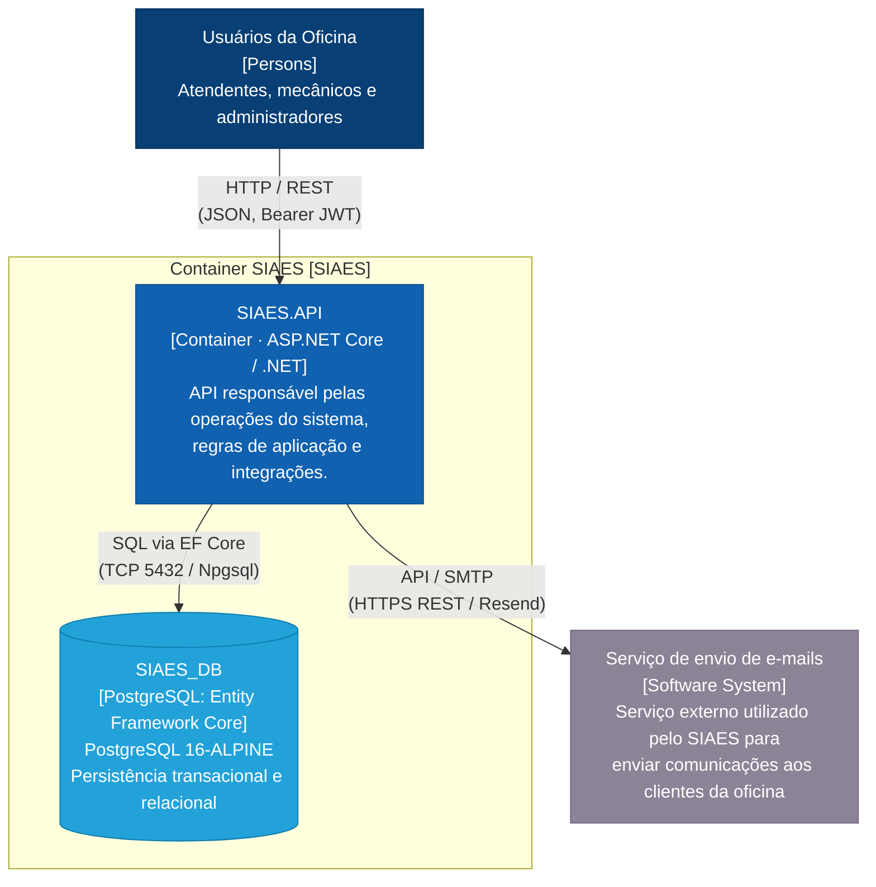

# Diagrama de Contêineres (C2 do Modelo C4)

Este documento apresenta o **Diagrama de Contêineres (C2)** do sistema **SIAES (Sistema Integrado de Atendimento e Execução de Serviços)**, detalhando os contêineres de software de alto nível executáveis (aplicações, APIs e bancos de dados), seus protocolos de comunicação e como eles interagem entre si e com serviços externos.

O modelo segue fielmente a especificação definida no arquivo [`C4_ClientesVeiculos_Container_C2.drawio`](drawio/C4_ClientesVeiculos_Container_C2.drawio).

---

## 1. Visão Geral (Nível C2)

No modelo C4, o diagrama de **Contêineres (C2)** decompõe o sistema de software em seus blocos executáveis ou armazenamentos de dados independentes (cada um podendo ser implantado, escalado e executado separadamente):
- **Aplicações e APIs**: onde residem as regras e a interface programática.
- **Armazenamento de Dados**: bancos relacionais ou NoSQL para persistência durável.
- **Protocolos e Portas**: a tecnologia de transporte e integração (`HTTP / REST`, `SQL / TCP 5432`, `API / SMTP`).

---

## 2. Diagrama C2 — Contêineres do Sistema

---

## 3. Catálogo de Contêineres e Tecnologias

### 3.1. Contêineres Internos

| Contêiner | Tipo / Tecnologia | Descrição e Responsabilidade |
| :--- | :--- | :--- |
| **`SIAES.API`** | `Container · ASP.NET Core / .NET 10` | Aplicação Web API backend monolítica modularizada em Clean Architecture. Expõe endpoints RESTful com versionamento (`v1`), gerencia autenticação JWT (RBAC), orquestra os casos de uso de negócio, valida dados e criptografa dados sensíveis de clientes. |
| **`SIAES_DB`** | `Container: PostgreSQL 16-ALPINE` | Banco de dados relacional principal da oficina. Armazena as entidades de Clientes, Veículos, Ordens de Serviço, Histórico imutável de transições, Itens de Estoque e Usuários, com suporte a índices únicos e integridade referencial ACID. |

### 3.2. Integrações e Comunicação

| Origem | Destino | Protocolo / Transporte | Descrição |
| :--- | :--- | :--- | :--- |
| **Usuários da Oficina** | **`SIAES.API`** | `HTTP / REST` | Requisições HTTP com payload JSON protegidas por tokens Bearer JWT via Swagger UI, cliente web ou requisições de terminal. |
| **`SIAES.API`** | **`SIAES_DB`** | `SQL via EF Core` | Conexão relacional via porta 5432 usando Npgsql e Entity Framework Core 10, com pool de conexões e migrações automáticas. |
| **`SIAES.API`** | **Serviço de e-mails** | `API / SMTP` | Chamadas HTTP/REST criptografadas (TLS 1.3) ao provedor de mensageria (Resend API) para notificações operacionais. |

---

## 4. Arquivo Draw.io Nativo

O diagrama original editável está disponível em:
- 📁 [`docs/architecture/drawio/C4_ClientesVeiculos_Container_C2.drawio`](drawio/C4_ClientesVeiculos_Container_C2.drawio)

