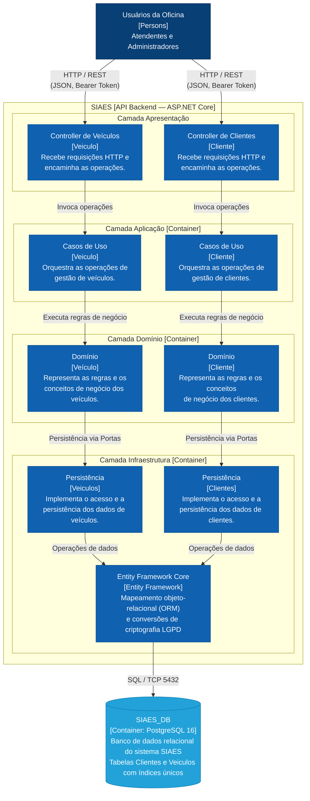
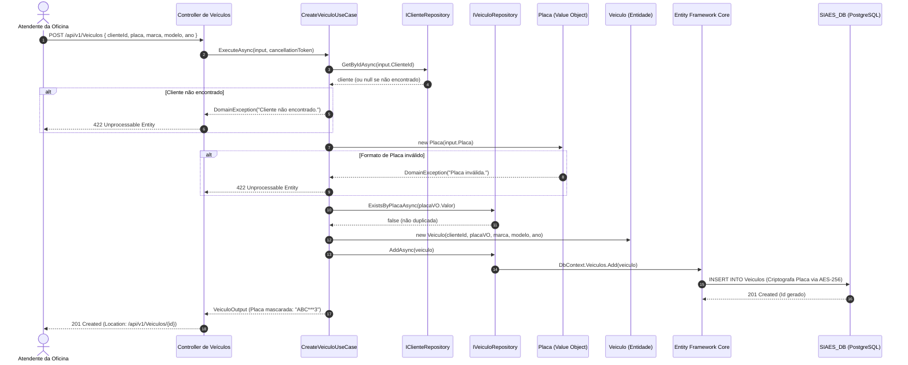

# Diagrama de Componentes (C3 do Modelo C4) — Cliente e Veículo

Este documento descreve a arquitetura do subsistema de **Cliente e Veículo** no sistema **SIAES**, apresentando o **Diagrama de Componentes (C3 do modelo C4)** que detalha as camadas de software da API Backend, a organização dos casos de uso, as regras do domínio, a persistência e a conformidade com a LGPD.

O modelo segue fielmente a estrutura e a representação de camadas definida no arquivo [`C4_ClientesVeiculos_Component_C3.drawio`](drawio/C4_ClientesVeiculos_Component_C3.drawio).

---

## 1. Visão Geral (Nível C3)

No modelo C4, o diagrama **C3 (Component)** detalha a organização interna do contêiner **`SIAES.API` (.NET 10 / ASP.NET Core)** para os módulos de **Clientes** e **Veículos**:
- **Apresentação (`SIAES.API`)**: Controladores REST que recebem as requisições HTTP, executam autenticação JWT e delegam a execução.
- **Camada Aplicação (`Application`)**: Casos de uso especializados que orquestram validações, consultas e comandos de escrita.
- **Camada Domínio (`Domain`)**: Entidades ricas (`Cliente`, `Veiculo`) e Value Objects imutáveis (`Documento`, `Placa`, `Endereco`) encapsulando invariantes de negócio.
- **Camada Infraestrutura (`Infrastructure`)**: Repositórios de persistência, mapeamentos ORM com o Entity Framework Core e conversão criptográfica determinística (AES-256) para conformidade com a LGPD.
- **Banco de Dados (`SIAES_DB`)**: Armazenamento relacional PostgreSQL 16 com integridade referencial estrita e índices únicos B-Tree.

---

## 2. Diagrama C3 — Componentes de Cliente e Veículo

---

## 3. Catálogo Detalhado de Componentes

### 3.1. Camada de Apresentação (`src/SIAES.API`)

| Componente | Tipo / Arquivo | Responsabilidade |
| :--- | :--- | :--- |
| **`Controller de Veículos`** | [`VeiculosController.cs`](file:///home/marcoswferreira/repos/tech-challenge/src/SIAES.API/Controllers/v1/VeiculosController.cs) | Endpoints REST `/api/v1/Veiculos` para cadastro, consulta por ID, listagem paginada, atualização cadastral e remoção lógica (soft delete). |
| **`Controller de Clientes`** | [`ClientesController.cs`](file:///home/marcoswferreira/repos/tech-challenge/src/SIAES.API/Controllers/v1/ClientesController.cs) | Endpoints REST `/api/v1/Clientes` para registro de clientes pessoa física/jurídica, consultas, atualização e exclusão lógica. |

### 3.2. Camada de Aplicação (`src/Application`)

| Componente | Casos de Uso Implementados | Responsabilidade |
| :--- | :--- | :--- |
| **`Casos de Uso [Veiculo]`** | • `CreateVeiculoUseCase` • `GetVeiculoByIdUseCase` • `GetVeiculosPagedUseCase` • `UpdateVeiculoUseCase` • `DeleteVeiculoUseCase` | Validação de existência do cliente proprietário (`ClienteId`), verificação de unicidade da placa no banco, coordenação de transações e transformação de entidades em DTOs mascarados. |
| **`Casos de Uso [Cliente]`** | • `CreateClienteUseCase` • `GetClienteByIdUseCase` • `GetClientesPagedUseCase` • `UpdateClienteUseCase` • `DeleteClienteUseCase` | Validação estrutural de entrada (`ClienteValidator`), verificação de documento duplicado (CPF/CNPJ) e montagem de saídas DTO mascaradas em conformidade com a LGPD. |

### 3.3. Camada de Domínio (`src/Domain`)

| Componente | Elementos e Value Objects | Responsabilidade |
| :--- | :--- | :--- |
| **`Domínio [Veículo]`** | Entidade [`Veiculo.cs`](file:///home/marcoswferreira/repos/tech-challenge/src/Domain/Entities/Veiculo.cs) Value Object [`Placa.cs`](file:///home/marcoswferreira/repos/tech-challenge/src/Domain/ValueObjects/Placa.cs) Porta [`IVeiculoRepository.cs`](file:///home/marcoswferreira/repos/tech-challenge/src/Domain/Repositories/IVeiculoRepository.cs) | Modela o veículo atendido na oficina. O Value Object `Placa` valida os formatos brasileiro tradicional (`AAA-9999`) e Mercosul (`AAA9A99`), além de expor as variantes formatada e mascarada (`ABC***3`). |
| **`Domínio [Cliente]`** | Raiz de Agregado [`Cliente.cs`](file:///home/marcoswferreira/repos/tech-challenge/src/Domain/Entities/Cliente.cs) Value Object [`Documento.cs`](file:///home/marcoswferreira/repos/tech-challenge/src/Domain/ValueObjects/Documento.cs) Value Object [`Endereco.cs`](file:///home/marcoswferreira/repos/tech-challenge/src/Domain/ValueObjects/Endereco.cs) Porta [`IClienteRepository.cs`](file:///home/marcoswferreira/repos/tech-challenge/src/Domain/Repositories/IClienteRepository.cs) | Raiz de agregado que encapsula a coleção de veículos de um proprietário. O Value Object `Documento` calcula os dígitos verificadores para CPF (11 dígitos) e CNPJ (14 dígitos), rejeitando documentos inválidos com `DomainException`. |

### 3.4. Camada de Infraestrutura (`src/Infrastructure`)

| Componente | Tipo / Arquivo | Responsabilidade |
| :--- | :--- | :--- |
| **`Persistência [Veiculos]`** | [`VeiculoRepository.cs`](file:///home/marcoswferreira/repos/tech-challenge/src/Infrastructure/Repositories/VeiculoRepository.cs) | Implementação concreta de `IVeiculoRepository` com consultas otimizadas, filtros de exclusão lógica (`IsActive`) e busca por placa criptografada. |
| **`Persistência [Clientes]`** | [`ClienteRepository.cs`](file:///home/marcoswferreira/repos/tech-challenge/src/Infrastructure/Repositories/ClienteRepository.cs) | Implementação concreta de `IClienteRepository` com suporte a paginação `PagedResult<Cliente>`, busca por documento criptografado e carregamento de veículos vinculados. |
| **`Entity Framework Core`** | [`ApplicationDbContext.cs`](file:///home/marcoswferreira/repos/tech-challenge/src/Infrastructure/Database/ApplicationDbContext.cs) [`DeterministicEncryption.cs`](file:///home/marcoswferreira/repos/tech-challenge/src/Infrastructure/Security/DeterministicEncryption.cs) | ORM configurado com migrações e `ValueConverter` que aplica criptografia determinística AES-256 no armazenamento de `Documento` e `Placa`, viabilizando índices únicos e buscas diretas no PostgreSQL sem expor texto plano no disco. |

---

## 4. Diagramas de Sequência

### 4.1. Cadastro de Veículo com Validação de Integridade e Placa

---

## 5. Arquivo Draw.io Nativo

O diagrama original editável está disponível em:
- 📁 [`docs/architecture/drawio/C4_ClientesVeiculos_Component_C3.drawio`](drawio/C4_ClientesVeiculos_Component_C3.drawio)
