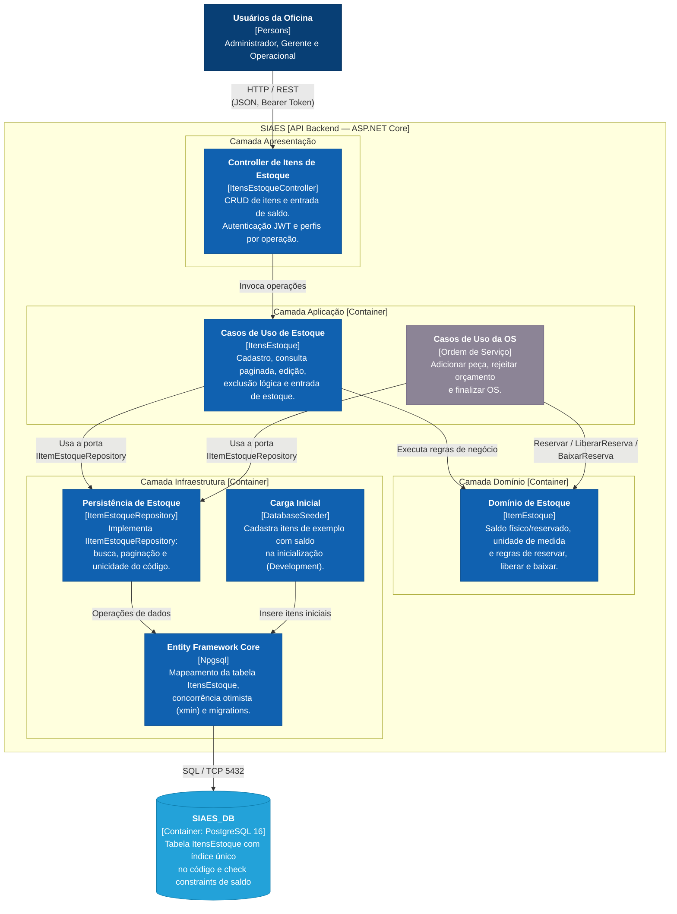
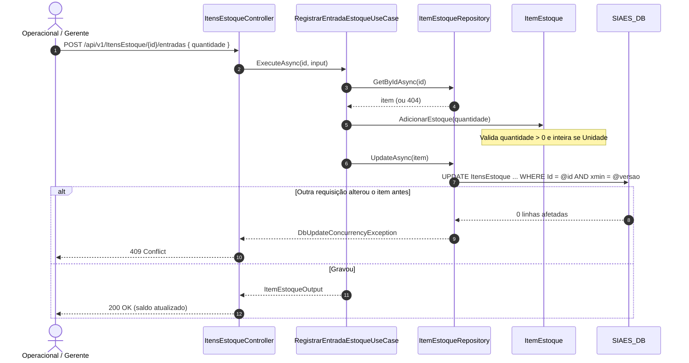
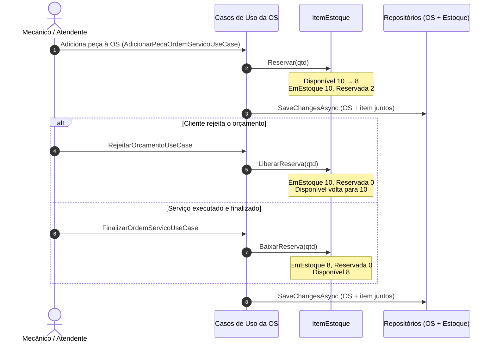

# Diagrama de Componentes (C3 do Modelo C4) — Estoque

Este documento descreve o **Diagrama de Componentes (C3 do modelo C4)** do módulo de **Estoque** do SIAES: o cadastro de itens de estoque (peças e insumos), a entrada de saldo e as operações de reserva, liberação e baixa que são disparadas pela Ordem de Serviço.

O diagrama editável está em [`C4_Estoque_Component_C3.drawio`](drawio/C4_Estoque_Component_C3.drawio).

---

## 1. Visão Geral

O módulo de Estoque tem dois consumidores dentro da API:

- **Usuários da oficina**, pelo `ItensEstoqueController`: cadastram, consultam, editam e excluem itens, e registram entradas (reposição) de saldo.
- **Casos de uso da Ordem de Serviço**, que usam a entidade `ItemEstoque` diretamente: reservam o item quando a peça é adicionada à OS, liberam a reserva quando o orçamento é rejeitado e dão baixa quando a OS é finalizada.

Por isso não existem endpoints de reserva ou baixa no estoque. Essas operações só acontecem dentro do fluxo da OS, sempre na mesma transação que grava a OS.

O saldo de cada item é controlado por três valores:

| Campo | Significado |
| :--- | :--- |
| `QuantidadeEmEstoque` | Quantidade física na oficina |
| `QuantidadeReservada` | Parte do estoque físico já comprometida com OS em andamento |
| `QuantidadeDisponivel` | `QuantidadeEmEstoque - QuantidadeReservada` (calculado, não é gravado) |

---

## 2. Diagrama C3 — Componentes de Estoque

> Os **Casos de Uso da OS** aparecem em cinza porque pertencem ao módulo de Ordem de Serviço (detalhado no [C3 — Ordem de Serviço](c3-ordem-servico.md)). Eles entram aqui só por serem os únicos que reservam, liberam e baixam estoque.

---

## 3. Catálogo de Componentes

### 3.1. Camada de Apresentação (`src/SIAES.API`)

**`ItensEstoqueController`** — rota base `/api/v1/ItensEstoque`. Toda a classe exige usuário autenticado (`[Authorize]`); as operações de escrita restringem os perfis.

| Método | Rota | Perfis | Descrição |
| :--- | :--- | :--- | :--- |
| `POST` | `/` | Admin, Manager, Operacional | Cadastra o item com estoque zerado. Retorna `201 Created`. |
| `GET` | `/?pageIndex=0&pageSize=10` | Qualquer autenticado | Lista paginada, ordenada por nome. Itens excluídos não aparecem. |
| `GET` | `/{id}` | Qualquer autenticado | Retorna o item com os três saldos. |
| `PUT` | `/{id}` | Admin, Manager, Operacional | Altera nome, descrição, unidade e preço. Código e saldo não mudam. |
| `DELETE` | `/{id}` | Admin, Manager | Exclusão lógica. Bloqueada se o item tiver quantidade reservada. |
| `POST` | `/{id}/entradas` | Admin, Manager, Operacional | Soma uma quantidade ao estoque físico (reposição). |

Os erros são convertidos pelo `ExceptionHandler` (Infrastructure) em `ProblemDetails`: `400` para validação (`ArgumentException`/`InvalidOperationException`), `404` para item não encontrado e `409` para conflito de concorrência (`DbUpdateConcurrencyException`).

### 3.2. Camada de Aplicação (`src/Application/UseCases/ItensEstoque`)

| Componente | Responsabilidade |
| :--- | :--- |
| **`CreateItemEstoqueUseCase`** | Valida código e nome, verifica se o código já existe (inclusive em itens excluídos) e cadastra o item. |
| **`GetItemEstoqueByIdUseCase`** | Busca o item por ID ou lança `KeyNotFoundException`. |
| **`GetItensEstoquePagedUseCase`** | Lista paginada convertida para `ItemEstoqueOutput`. |
| **`UpdateItemEstoqueUseCase`** | Atualiza os dados cadastrais via `ItemEstoque.Atualizar`. |
| **`DeleteItemEstoqueUseCase`** | Impede a exclusão de item com reserva (`PossuiReserva()`) e faz o soft delete. |
| **`RegistrarEntradaEstoqueUseCase`** | Chama `ItemEstoque.AdicionarEstoque` e persiste o novo saldo. |

DTOs: `CreateItemEstoqueInput`, `UpdateItemEstoqueInput`, `EntradaEstoqueInput` e `ItemEstoqueOutput` (este já traz a `QuantidadeDisponivel` calculada).

**Consumidores do módulo de OS** (`src/Application/UseCases/OrdensServico`):

| Caso de uso da OS | Operação no estoque | Quando |
| :--- | :--- | :--- |
| `AdicionarPecaOrdemServicoUseCase` | `itemEstoque.Reservar(quantidade)` | Peça incluída na OS durante o diagnóstico |
| `RejeitarOrcamentoUseCase` | `itemEstoque.LiberarReserva(quantidade)` para cada peça da OS | Cliente rejeita o orçamento (OS cancelada) |
| `FinalizarOrdemServicoUseCase` | `itemEstoque.BaixarReserva(quantidade)` para cada peça da OS | Serviço concluído |

Nos três casos o item e a OS são salvos no mesmo `SaveChangesAsync`, então a alteração de saldo e a da OS são gravadas na mesma transação. Na rejeição e na finalização, uma peça só altera o item se ele ainda tiver quantidade reservada suficiente; caso contrário, aquela peça é ignorada e o restante do fluxo segue.

### 3.3. Camada de Domínio (`src/Domain`)

| Componente | Tipo | Responsabilidade |
| :--- | :--- | :--- |
| **`ItemEstoque`** | Entidade / Raiz de Agregado (`SoftDeleteBaseEntity`) | Representa uma peça ou insumo. Normaliza o código (maiúsculo e sem espaços nas pontas), valida nome, unidade e preço, e concentra as regras de saldo descritas na seção 4. |
| **`UnidadeMedida`** | Enum (`Unidade`, `Litro`, `Quilo`) | Define como a quantidade é controlada. `Unidade` só aceita valores inteiros; `Litro` e `Quilo` aceitam frações. Serializado como texto na API. |
| **`IItemEstoqueRepository`** | Porta (interface) | Contrato de persistência: `GetByIdAsync`, `ExistsByCodigoAsync`, `GetPagedAsync`, `AddAsync`, `UpdateAsync`, `DeleteAsync`, além dos métodos herdados de `IBaseRepository`. |
| **`ItemPeca`** | Value Object (módulo OS) | Guarda na OS um snapshot do item (ID, nome e preço) no momento em que a peça é adicionada. O preço é o do cadastro, a menos que outro valor seja informado na OS; também valida quantidade inteira para itens em `Unidade`. |

### 3.4. Camada de Infraestrutura (`src/Infrastructure`)

| Componente | Responsabilidade |
| :--- | :--- |
| **`ItemEstoqueRepository`** | Implementa `IItemEstoqueRepository` com EF Core. A checagem de código duplicado usa `IgnoreQueryFilters()` para não permitir reaproveitar o código de um item excluído. |
| **`ItemEstoqueMapping`** | Mapeia a tabela `ItensEstoque`: índice único em `Codigo`, `UnidadeMedida` gravada como texto, precisão `numeric(12,2)` no preço e `numeric(12,3)` nas quantidades, `Versao` mapeada para o `xmin` do PostgreSQL e check constraints `CK_ItensEstoque_QuantidadeEmEstoque` (estoque ≥ 0) e `CK_ItensEstoque_QuantidadeReservada` (0 ≤ reservado ≤ estoque). |
| **`ApplicationDbContext`** | Expõe o `DbSet<ItemEstoque>`, aplica o filtro global de soft delete e preenche os campos de auditoria (`CreatedBy`, `LastModifiedBy`). |
| **Migration `AddItensEstoque`** | Cria a tabela `ItensEstoque` e seus índices/constraints. |
| **`DatabaseSeeder.SeedItensEstoqueAsync`** | Na inicialização em Development, cadastra 11 itens de exemplo (filtros, pastilha, disco, vela, bateria, óleo, fluido de freio, aditivo e graxa) já com saldo, ignorando os códigos que já existem. |

---

## 4. Regras de Saldo

| Operação | Quem chama | Validação | Efeito |
| :--- | :--- | :--- | :--- |
| `AdicionarEstoque(q)` | `RegistrarEntradaEstoqueUseCase` / seeder | `q > 0`; inteiro se `Unidade` | `EmEstoque += q` |
| `Reservar(q)` | `AdicionarPecaOrdemServicoUseCase` | `q > 0`; inteiro se `Unidade`; `q ≤ Disponivel` | `Reservada += q` |
| `LiberarReserva(q)` | `RejeitarOrcamentoUseCase` | `q > 0`; `q ≤ Reservada` | `Reservada -= q` |
| `BaixarReserva(q)` | `FinalizarOrdemServicoUseCase` | `q > 0`; `q ≤ Reservada` | `Reservada -= q` e `EmEstoque -= q` |

Outras regras:

- Um item não pode mudar para `Unidade` se já tiver saldo fracionado.
- Um item com reserva não pode ser excluído.
- O banco também rejeita estoque negativo e reserva maior que o estoque (check constraints), como última barreira.
- Se duas requisições alterarem o mesmo item ao mesmo tempo (por exemplo, duas OS reservando a última unidade), o `xmin` muda na primeira gravação e a segunda recebe `409 Conflict`.

---

## 5. Fluxos

### 5.1. Entrada de estoque

### 5.2. Ciclo de reserva pela Ordem de Serviço

---

## 6. Decisões de Design

1. **Reserva e baixa em duas fases.** A peça é reservada quando entra na OS e só sai do estoque físico na finalização. Assim o saldo disponível já reflete o que está comprometido, e uma rejeição de orçamento devolve tudo sem ajuste manual.
2. **Estoque sem endpoints de reserva/baixa.** Essas operações só fazem sentido dentro do ciclo da OS, então ficam como métodos da entidade, chamados pelos casos de uso da OS. Isso evita que alguém reserve ou baixe estoque sem uma OS associada.
3. **Concorrência otimista com `xmin`.** Em vez de travar linhas, cada atualização confere a versão da linha. É simples, não exige coluna extra e protege contra duas OS consumindo o mesmo saldo.
4. **Unidade de medida fechada.** Um enum com três opções evita variações de texto (`L`, `LT`, `LITRO`) e permite validar quantidade inteira para itens por unidade.
5. **Código informado pelo usuário.** O código do item não é gerado pelo sistema, para que a oficina possa usar o código do fabricante ou o que já usa internamente. Ele é único e não pode ser alterado depois do cadastro.

---

## 7. Arquivo Draw.io

- 📁 [`docs/architecture/drawio/C4_Estoque_Component_C3.drawio`](drawio/C4_Estoque_Component_C3.drawio)
