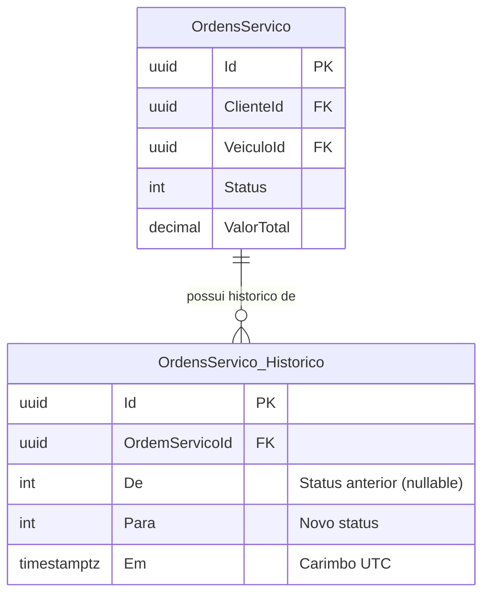

# Arquitetura de Componentes (C3) — Gerenciamento de Estado (Status da OS)

Este documento descreve a arquitetura do **Gerenciamento de Estado** da Ordem de Serviço no sistema **SIAES**, apresentando o **Diagrama de Componentes (C3 do modelo C4)** que retrata a Máquina de Estados Finita (FSM), suas regras de transição, invariantes, auditoria imutável e efeitos colaterais.

---

## 1. Visão Geral

O gerenciamento de estado da Ordem de Serviço é implementado com foco em **integridade de dados**, **auditoria contínua** e **previsibilidade operacional**:
- **Encapsulamento no Domínio**: O status da OS não pode ser alterado arbitrariamente via setters públicos ou comandos genéricos de update. Qualquer alteração passa por métodos de negócio expressivos no agregado `OrdemServico`.
- **Máquina de Estados Finita (FSM)**: Transições entre estados seguem um grafo direcionado e estrito. Tentativas de violar o fluxo (ex.: aprovar uma OS ainda em `Recebida`) resultam em `DomainException`, traduzida para HTTP `422 Unprocessable Entity`.
- **Auditoria Imutável em Tempo Real**: Cada transição gera um registro indelével na entidade `RegistroStatus` persistido na tabela `OrdensServico_Historico` com carimbo de data/hora UTC (`DateTime.UtcNow`).
- **Efeitos Colaterais Controlados**: Mudanças de estado desencadeiam orquestrações de estoque (reserva, liberação ou baixa física) e notificações automáticas ao cliente por e-mail.

---

## 2. Diagrama C3 — Componentes do Gerenciamento de Estado

```mermaid
flowchart TD
    %% Usuários
    AtorOperacional(["Atendente / Mecânico\n[Ator Operacional]"]):::person
    ClienteConsulta(["Cliente\n[Ator Externo - Consulta Pública]"]):::person

    subgraph ContainerAPI ["Contêiner: SIAES Backend API (.NET 10 / ASP.NET Core)"]

        %% Apresentação
        subgraph PresentationLayer ["Camada de Apresentação (SIAES.API)"]
            OSController["OrdensServicoController\n[Component: ASP.NET Core Controller]\nExpõe rotas de comando de transição e consultas públicas"]:::component
            GlobalExceptionHandler["ExceptionHandler\n[Component: IExceptionHandler]\nMapeia DomainException -> 422 Unprocessable Entity"]:::component
        end

        %% Aplicação
        subgraph ApplicationLayer ["Camada de Aplicação (Application)"]
            subgraph TransitionUseCases ["Use Cases de Transição de Estado"]
                UC_Diag["IniciarDiagnosticoUseCase\n[Component]\nRecebida -> EmDiagnostico"]:::component
                UC_Budget["GerarOrcamentoUseCase\n[Component]\nEmDiagnostico -> AguardandoAprovacao"]:::component
                UC_Approve["AprovarOrcamentoUseCase\n[Component]\nAguardandoAprovacao -> EmExecucao"]:::component
                UC_AddApproval["SolicitarAprovacaoAdicionalUseCase\n[Component]\nEmExecucao -> AguardandoAprovacao"]:::component
                UC_Reject["RejeitarOrcamentoUseCase\n[Component]\nAguardandoAprovacao -> Cancelada"]:::component
                UC_Finish["FinalizarOrdemServicoUseCase\n[Component]\nEmExecucao -> Finalizada"]:::component
                UC_Deliver["EntregarVeiculoUseCase\n[Component]\nFinalizada -> Entregue"]:::component
            end

            subgraph StatusQueries ["Use Cases de Consulta de Status"]
                UC_GetStatus["GetStatusOrdemServicoUseCase\n[Component]\nConsulta pública (ID / CPF / CNPJ)"]:::component
            end
        end

        %% Domínio
        subgraph DomainLayer ["Camada de Domínio (Domain - Core Puro)"]
            subgraph StateMachine ["Máquina de Estados no Agregado"]
                OSAggregate["OrdemServico (Aggregate Root)\n[Component: Entity]\nStatus atual: StatusOrdemServico"]:::component
                MudarStatusMethod["MudarStatus(novoStatus)\n[Método Privado]\nValida fluxo e cria RegistroStatus"]:::component
                RegistroStatusEntity["RegistroStatus\n[Component: Entity]\nHistórico: De, Para, Data/Hora UTC"]:::component
            end

            DomainExceptions["DomainException\n[Component: Exception]\nViolação de regra de transição de status"]:::component
            
            subgraph StatePorts ["Portas de Persistência e Efeitos"]
                IOSRepoPort["IOrdemServicoRepository\n[Interface: Porta]"]:::interface
                IStockPort["IItemEstoqueRepository\n[Interface: Porta]"]:::interface
                INotifPort["IOrdemServicoNotificationService\n[Interface: Porta]"]:::interface
            end
        end

        %% Infraestrutura
        subgraph InfrastructureLayer ["Camada de Infraestrutura (Infrastructure)"]
            OSRepository["OrdemServicoRepository\n[Component: EF Core Repository]\nPersiste OS + Histórico em cascata"]:::component
            StockRepository["ItemEstoqueRepository\n[Component: EF Core Repository]\nGerencia saldo físico e reservas"]:::component
            NotificationService["OrdemServicoNotificationService\n[Component: C# Service]\nDispara templates de e-mail por status"]:::component
            DbContext["ApplicationDbContext\n[Component: EF Core]\nMapeia tabelas relacionais"]:::component
        end

    end

    %% Provedores Externos
    subgraph ExternalSystems ["Persistência e Mensageria Externa"]
        PostgresDB[("PostgreSQL 16\n[Database]\nOrdensServico e OrdensServico_Historico")]:::db
        ResendSaaS["Resend Email Service\n[SaaS Externo]\nEnvio transacional de e-mails"]:::external
    end

    %% Conexões de Apresentação
    AtorOperacional -->|"POST /{id}/[acao]"| OSController
    ClienteConsulta -->|"GET /{id}/status ou /documento/{doc}/status"| OSController
    OSController --> TransitionUseCases
    OSController --> StatusQueries
    OSController -.->|"Captura exceção de transição"| GlobalExceptionHandler

    %% Conexões de Aplicação para Domínio
    TransitionUseCases -->|"Invoca método de transição"| OSAggregate
    StatusQueries -->|"Lê status e histórico"| IOSRepoPort
    OSAggregate --> MudarStatusMethod
    MudarStatusMethod -->|"Cria e adiciona"| RegistroStatusEntity
    MudarStatusMethod -.->|"Se status inválido"| DomainExceptions

    %% Efeitos Colaterais das Transições
    UC_Reject -->|"Libera reservas"| IStockPort
    UC_Finish -->|"Baixa física"| IStockPort
    TransitionUseCases -->|"Dispara e-mail correspondente"| INotifPort
    TransitionUseCases -->|"Persiste estado e histórico"| IOSRepoPort

    %% Implementações de Infraestrutura
    OSRepository -.->|"Implementa"| IOSRepoPort
    StockRepository -.->|"Implementa"| IStockPort
    NotificationService -.->|"Implementa"| INotifPort

    %% Acesso a Banco e Rede
    OSRepository --> DbContext
    StockRepository --> DbContext
    DbContext -->|"SQL / TCP"| PostgresDB
    NotificationService -->|"HTTPS / REST"| ResendSaaS

    %% Estilos visuais C4
    classDef person fill:#08427b,stroke:#052e56,color:#ffffff;
    classDef component fill:#1168bd,stroke:#0b4884,color:#ffffff;
    classDef interface fill:#85bb65,stroke:#557a3e,color:#ffffff;
    classDef db fill:#1f77b4,stroke:#0f5280,color:#ffffff;
    classDef external fill:#666666,stroke:#444444,color:#ffffff;
```



---

## 3. Matriz de Estados e Transições Implementadas

A tabela abaixo documenta todas as transições válidas suportadas pelo modelo de domínio:

| Status Origem (`De`) | Status Destino (`Para`) | Endpoint HTTP | Método no Domínio | Invariantes e Regras de Negócio | Efeito Colateral Associado |
| :--- | :--- | :--- | :--- | :--- | :--- |
| — | `Recebida` | `POST /api/v1/ordens-servico` | `new OrdemServico(clienteId, veiculoId)` | Cliente e veículo devem existir previamente. | Cria primeiro `RegistroStatus(null, Recebida)`. Notifica cliente por e-mail: *"Veículo Recebido"*. |
| `Recebida` | `EmDiagnostico` | `POST /api/v1/ordens-servico/{id}/diagnostico` | `os.IniciarDiagnostico()` | A OS deve estar em `Recebida`. | Permite adição de peças e serviços na OS. |
| `EmDiagnostico` | `AguardandoAprovacao` | `POST /api/v1/ordens-servico/{id}/orcamento` | `os.GerarEEnviarOrcamento()` | **`ValorTotal > 0`**: É obrigatório ter ao menos uma peça ou serviço adicionado. | Notifica cliente por e-mail com a tabela de valores: *"Orçamento Disponível para Aprovação"*. |
| `AguardandoAprovacao` | `EmExecucao` | `POST /api/v1/ordens-servico/{id}/aprovar` | `os.AprovarOrcamento()` | A OS deve estar em `AguardandoAprovacao`. | Notifica cliente por e-mail: *"Orçamento Aprovado"*. |
| `AguardandoAprovacao` | `Cancelada` | `POST /api/v1/ordens-servico/{id}/rejeitar` | `os.RejeitarOrcamento()` | A OS deve estar em `AguardandoAprovacao`. | **Reversão de estoque**: `itemEstoque.LiberarReserva()`. Notifica cliente: *"Orçamento Rejeitado"*. |
| `EmExecucao` | `AguardandoAprovacao` | `POST /api/v1/ordens-servico/{id}/solicitar-aprovacao-adicional` | `os.SolicitarAprovacaoAdicional()` | A OS deve estar em `EmExecucao`. Permite incluir novos reparos imprevistos. | Reenvia e-mail com orçamento atualizado para nova aprovação. |
| `EmExecucao` | `Finalizada` | `POST /api/v1/ordens-servico/{id}/finalizar` | `os.FinalizarServico()` | A OS deve estar em `EmExecucao`. | **Baixa física de estoque**: `itemEstoque.BaixarReserva()`. Notifica cliente: *"Veículo Pronto para Retirada"*. |
| `Finalizada` | `Entregue` | `POST /api/v1/ordens-servico/{id}/entregar` | `os.EntregarVeiculo()` | A OS deve estar em `Finalizada`. | Encerra ciclo de atendimento. Notifica cliente: *"Veículo Entregue"*. |

---

## 4. O Fluxo de Transição no Código do Agregado

O coração da máquina de estados fica em [`src/Domain/Entities/OrdemServico.cs`](../../src/Domain/Entities/OrdemServico.cs):

```csharp
private void MudarStatus(StatusOrdemServico novoStatus)
{
    var statusAnterior = Status;
    Status = novoStatus;
    _historico.Add(new RegistroStatus(Id, statusAnterior, novoStatus, DateTime.UtcNow));
}
```

### Invariantes e Tratamento de Violação

Quando uma transição não é permitida pelas regras de negócio, o método do agregado interrompe a execução imediatamente lançando `DomainException`:

```csharp
public void AprovarOrcamento()
{
    if (Status != StatusOrdemServico.AguardandoAprovacao)
        throw new DomainException(
            $"Não é possível aprovar o orçamento com a OS em '{Status}'.");

    MudarStatus(StatusOrdemServico.EmExecucao);
}
```

O middleware central de exceções (`ExceptionHandler` em [`src/Infrastructure/ExceptionHandler.cs`](../../src/Infrastructure/ExceptionHandler.cs)) intercepta a `DomainException` e escreve a resposta padronizada RFC 7807:

```json
HTTP/1.1 422 Unprocessable Entity
Content-Type: application/problem+json

{
  "type": "DomainException",
  "title": "Regra de negócio violada",
  "status": 422,
  "detail": "Não é possível aprovar o orçamento com a OS em 'Recebida'.",
  "instance": "POST /api/v1/ordens-servico/a1b2c3d4-e5f6-7a8b-9c0d-1e2f3a4b5c6d/aprovar",
  "traceId": "00-f9f910a6e2fb5819de07322f6ad6e8e9-509dd96602a22d08-00",
  "requestId": "0HNPEAGJNCOV2:00000001"
}
```

---

## 5. Rastreabilidade e Persistência do Histórico

A persistência do histórico de status é modelada via **Entity Framework Core 10** mapeada para a tabela relacional `OrdensServico_Historico`:



### Características de Auditoria
- **Imutabilidade**: Os registros da tabela `OrdensServico_Historico` são exclusivamente criados (`INSERT`), sem suporte a atualização ou exclusão lógica direta.
- **Relacionamento em Cascata**: Configurado no `OrdemServicoMap` com `HasMany(os => os.Historico).WithOne().HasForeignKey(r => r.OrdemServicoId).OnDelete(DeleteBehavior.Cascade)`.
- **Cálculo de Lead Time e SLA**: Cada entrada armazena o momento exato em que a OS mudou de fase, possibilitando auditorias sobre o tempo que a OS permaneceu em diagnóstico, aguardando aprovação ou em execução.

---

## 6. Consulta Pública Desacoplada

Para permitir que o cliente consulte o andamento do seu veículo sem necessidade de login, o componente `GetStatusOrdemServicoUseCase` consome a projeção otimizada `GetStatusClienteResponse`:
- **Por ID**: `GET /api/v1/ordens-servico/{id}/status`
- **Por CPF/CNPJ**: `GET /api/v1/ordens-servico/documento/{documento}/status`

O retorno traduz os termos técnicos para linguagem amigável ao cliente consumidor (ex.: `EmExecucao` torna-se *"Reparo autorizado e serviço em andamento"*).

