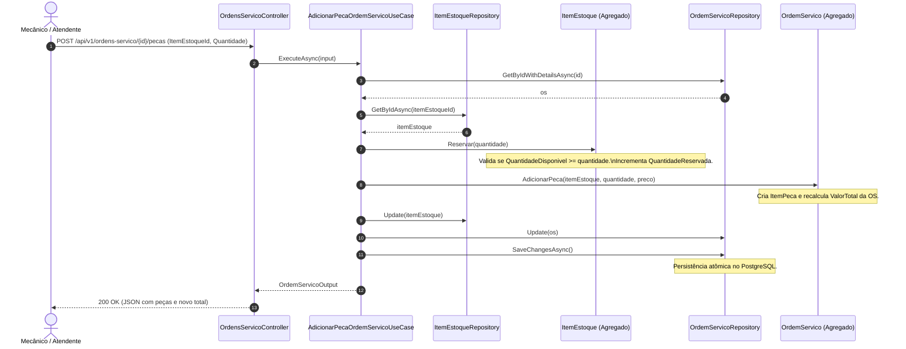
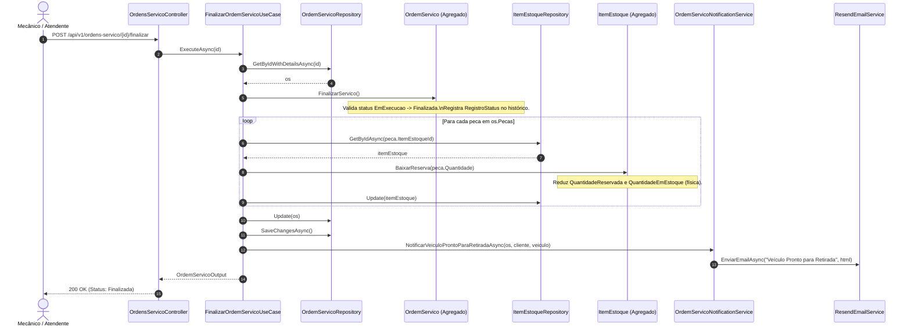

# Arquitetura de Componentes (C3) — Ordem de Serviço

Este documento detalha o **Diagrama de Componentes (C3 do modelo C4)** para o ecossistema da **Ordem de Serviço (OS)** no sistema **SIAES**. Ele descreve como o contêiner da **API Backend (.NET 10)** decompõe suas responsabilidades internas entre as camadas de **Apresentação**, **Aplicação**, **Domínio** e **Infraestrutura**, em estrita conformidade com o código-fonte implementado.

---

## 1. Visão Geral

No C4 Model, o diagrama **C3 (Component)** abre a "caixa preta" de um contêiner (a aplicação backend) para evidenciar os blocos de construção internos (controllers, use cases, agregados de domínio e adaptadores de infraestrutura), suas tecnologias e suas interações com sistemas e contêineres externos (banco de dados PostgreSQL e serviço de mensageria Resend).

A **Ordem de Serviço** é o agregado central do SIAES. Ela orquestra todo o ciclo de atendimento técnico de um veículo em uma oficina mecânica, conectando o cliente, o veículo diagnosticado, os serviços catalogados a serem prestados e os itens de estoque reservados e consumidos.

---

## 2. Diagrama C3 de Componentes (C4 Model)

```mermaid
flowchart TD
    %% Atores e Clientes Externos
    UsuarioOperacional(["Atendente / Mecânico / Gerente / Admin\n[Ator Humano]"]):::person
    ClienteOficina(["Cliente da Oficina\n[Ator Humano - Consulta Pública]"]):::person

    subgraph ContainerAPI ["Contêiner: SIAES Backend API (.NET 10 / ASP.NET Core)"]
        
        %% Camada de Apresentação
        subgraph PresentationLayer ["Camada de Apresentação (SIAES.API)"]
            OSController["OrdensServicoController\n[Component: ASP.NET Core Controller]\nRoteamento REST, validação de rotas e autorização RBAC"]:::component
            AuthFilter["Middleware de Segurança & JWT\n[Component: ASP.NET Core Middleware]\nValidação de Claims de Perfil (Roles)"]:::component
        end

        %% Camada de Aplicação
        subgraph ApplicationLayer ["Camada de Aplicação (Application)"]
            subgraph LifeCycleUseCases ["Casos de Uso de Ciclo de Vida"]
                CreateOS["CreateOrdemServicoUseCase\n[Component: C# Class]\nCria OS inicial (Recebida)"]:::component
                StartDiag["IniciarDiagnosticoUseCase\n[Component: C# Class]\nInicia avaliação técnica"]:::component
                AddItem["AdicionarPecaOrdemServicoUseCase\n[Component: C# Class]\nAdiciona peças e reserva estoque"]:::component
                AddService["AdicionarServicoOrdemServicoUseCase\n[Component: C# Class]\nAdiciona serviços da oficina"]:::component
                GenBudget["GerarOrcamentoUseCase\n[Component: C# Class]\nConsolida valores e envia p/ aprovação"]:::component
                ApproveBudget["AprovarOrcamentoUseCase\n[Component: C# Class]\nRegistra aprovação e inicia execução"]:::component
                ReqAddApproval["SolicitarAprovacaoAdicionalUseCase\n[Component: C# Class]\nRetorna OS para aprovação extra"]:::component
                RejectBudget["RejeitarOrcamentoUseCase\n[Component: C# Class]\nCancela OS e libera reserva de estoque"]:::component
                FinishOS["FinalizarOrdemServicoUseCase\n[Component: C# Class]\nBaixa estoque físico e conclui OS"]:::component
                DeliverVehicle["EntregarVeiculoUseCase\n[Component: C# Class]\nRegistra entrega do automóvel"]:::component
            end

            subgraph QueryUseCases ["Casos de Uso de Consulta"]
                GetById["GetOrdemServicoByIdUseCase\n[Component: C# Class]\nDetalhes da OS (peças, serviços e histórico)"]:::component
                GetPaged["GetOrdensServicoPagedUseCase\n[Component: C# Class]\nListagem paginada operacional"]:::component
                GetStatus["GetStatusOrdemServicoUseCase\n[Component: C# Class]\nConsulta pública de status por ID ou CPF/CNPJ"]:::component
            end

            DTOs["DTOs & Mappings\n[Component: Records]\nCreateOrdemServicoInput, OrdemServicoOutput, etc."]:::component
        end

        %% Camada de Domínio
        subgraph DomainLayer ["Camada de Domínio (Domain - Core Puro)"]
            OSAggregate["OrdemServico (Aggregate Root)\n[Component: C# Entity]\nEncapsula invariantes, cálculos e histórico"]:::component
            ItemPecaVO["ItemPeca (Value Object)\n[Component: Record]\nVínculo com ItemEstoque e valores"]:::component
            ItemServicoVO["ItemServico (Value Object)\n[Component: Record]\nDescrição, quantidade e valor unitário"]:::component
            RegistroStatusVO["RegistroStatus (Entity/VO)\n[Component: C# Entity]\nRastreabilidade imutável de transições"]:::component
            
            subgraph DomainPorts ["Portas do Domínio (Interfaces)"]
                IOSRepo["IOrdemServicoRepository\n[Interface: Porta]"]:::interface
                IStockRepo["IItemEstoqueRepository\n[Interface: Porta]"]:::interface
                ICliRepo["IClienteRepository\n[Interface: Porta]"]:::interface
                IVeicRepo["IVeiculoRepository\n[Interface: Porta]"]:::interface
                INotificationService["IOrdemServicoNotificationService\n[Interface: Porta]"]:::interface
            end
        end

        %% Camada de Infraestrutura
        subgraph InfrastructureLayer ["Camada de Infraestrutura (Infrastructure)"]
            OSRepo["OrdemServicoRepository\n[Component: EF Core Repository]\nConsultas otimizadas com AsSplitQuery"]:::component
            StockRepo["ItemEstoqueRepository\n[Component: EF Core Repository]\nControle de concorrência e saldo"]:::component
            AppDbContext["ApplicationDbContext\n[Component: EF Core DbContext]\nMapeamento relacional e auditoria"]:::component
            NotificationAdapter["OrdemServicoNotificationService\n[Component: C# Service]\nMontagem de templates HTML responsivos"]:::component
            ResendAdapter["ResendEmailService\n[Component: C# Service]\nCliente de integração HTTP"]:::component
        end

    end

    %% Contêineres e Sistemas Externos
    subgraph ExternalContainers ["Contêineres e Provedores Externos"]
        Database[("PostgreSQL 16 Database\n[Container: SGBD Relacional]\nTabelas OrdensServico, ItensEstoque, etc.")]:::db
        ResendAPI["Resend Email API\n[Software Externo: SaaS]\nEnvio transacional de e-mails"]:::external
    end

    %% Relacionamentos Presentation -> Auth
    UsuarioOperacional -->|"HTTP REST autenticado (Bearer JWT)"| OSController
    ClienteOficina -->|"HTTP GET público (/status)"| OSController
    OSController --> AuthFilter

    %% Relacionamentos Controller -> Use Cases
    OSController -->|"Invoca operações de escrita"| LifeCycleUseCases
    OSController -->|"Invoca consultas de leitura"| QueryUseCases
    LifeCycleUseCases -.-> DTOs
    QueryUseCases -.-> DTOs

    %% Relacionamentos Use Cases -> Domain
    LifeCycleUseCases -->|"Invoca métodos de negócio"| OSAggregate
    CreateOS -->|"Valida existência"| ICliRepo
    CreateOS -->|"Valida existência"| IVeicRepo
    AddItem -->|"Reserva quantidade"| IStockRepo
    RejectBudget -->|"Libera reservas"| IStockRepo
    FinishOS -->|"Baixa física de estoque"| IStockRepo
    LifeCycleUseCases -->|"Persiste estado"| IOSRepo
    LifeCycleUseCases -->|"Dispara e-mail de evento"| INotificationService
    QueryUseCases -->|"Lê agregados"| IOSRepo

    %% Composição do Agregado
    OSAggregate -->|"Contém"| ItemPecaVO
    OSAggregate -->|"Contém"| ItemServicoVO
    OSAggregate -->|"Contém"| RegistroStatusVO

    %% Implementação de Portas (Ports & Adapters)
    OSRepo -.->|"Implementa"| IOSRepo
    StockRepo -.->|"Implementa"| IStockRepo
    NotificationAdapter -.->|"Implementa"| INotificationService

    %% Relacionamentos de Infraestrutura
    OSRepo --> AppDbContext
    StockRepo --> AppDbContext
    NotificationAdapter --> ResendAdapter
    AppDbContext -->|"Npgsql / TCP 5432"| Database
    ResendAdapter -->|"HTTPS / REST"| ResendAPI

    %% Estilos visuais
    classDef person fill:#08427b,stroke:#052e56,color:#ffffff;
    classDef component fill:#1168bd,stroke:#0b4884,color:#ffffff;
    classDef interface fill:#85bb65,stroke:#557a3e,color:#ffffff;
    classDef db fill:#1f77b4,stroke:#0f5280,color:#ffffff;
    classDef external fill:#666666,stroke:#444444,color:#ffffff;
```

---

## 3. Catálogo de Componentes do Agregado

### 3.1. Camada de Apresentação (`src/SIAES.API`)

| Componente | Tipo / Tecnologia | Responsabilidade Principal |
| :--- | :--- | :--- |
| **`OrdensServicoController`** | Controller ASP.NET Core (`Microsoft.AspNetCore.Mvc`) | Ponto de entrada HTTP REST da OS. Recebe comandos e consultas, valida o binding dos modelos, delega a execução para o caso de uso apropriado e traduz resultados para códigos HTTP (`200 OK`, `201 Created`, `400 Bad Request`, `404 Not Found`, `422 Unprocessable Entity`). |
| **`AuthFilter & JWT Middleware`** | Pipeline de Segurança ASP.NET Core | Aplica autorização via atributo `[Authorize(Roles = "Administrador,Mecanico,Atendente")]` em nível de classe, protegendo todas as operações de escrita e listagem completa, enquanto libera o acesso anônimo com `[AllowAnonymous]` estritamente nas duas rotas públicas de acompanhamento de status. |

---

### 3.2. Camada de Aplicação (`src/Application`)

| Componente | Tipo | Responsabilidade Principal |
| :--- | :--- | :--- |
| **`CreateOrdemServicoUseCase`** | Caso de Uso | Valida a existência prévia do cliente (`IClienteRepository`) e do veículo (`IVeiculoRepository`), instancia a entidade `OrdemServico` com status inicial `Recebida`, persiste via `IOrdemServicoRepository` e notifica o cliente por e-mail. |
| **`IniciarDiagnosticoUseCase`** | Caso de Uso | Carrega a OS, executa o comando `os.IniciarDiagnostico()` (transição para `EmDiagnostico`) e salva o novo estado. |
| **`AdicionarPecaOrdemServicoUseCase`** | Caso de Uso | Busca a peça no catálogo de estoque (`IItemEstoqueRepository`), verifica a disponibilidade de saldo, executa `itemEstoque.Reservar(quantidade)`, adiciona o `ItemPeca` na OS, recalcula o orçamento e persiste as alterações atômicas no banco. |
| **`AdicionarServicoOrdemServicoUseCase`** | Caso de Uso | Adiciona mão de obra ou serviço técnico à OS (`ItemServico`), recalculando imediatamente o valor total do orçamento. |
| **`GerarOrcamentoUseCase`** | Caso de Uso | Valida se a OS possui itens adicionados (`ValorTotal > 0`), aciona `os.GerarEEnviarOrcamento()` (transição para `AguardandoAprovacao`) e dispara e-mail com a discriminação dos valores para o cliente aprovar. |
| **`AprovarOrcamentoUseCase`** | Caso de Uso | Registra o aceite do cliente (`os.AprovarOrcamento()`), efetuando a transição para `EmExecucao`, gravando o histórico e notificando por e-mail que o serviço foi iniciado. |
| **`SolicitarAprovacaoAdicionalUseCase`** | Caso de Uso | Utilizado quando uma nova avaria é detectada durante o reparo: executa `os.SolicitarAprovacaoAdicional()`, retornando a OS para `AguardandoAprovacao` e reenviando o orçamento revisado para o cliente. |
| **`RejeitarOrcamentoUseCase`** | Caso de Uso | Executa `os.RejeitarOrcamento()`, cancelando a OS (`Cancelada`), iterando sobre todas as peças adicionadas para reverter as reservas com `itemEstoque.LiberarReserva()`, devolvendo o saldo ao estoque disponível. |
| **`FinalizarOrdemServicoUseCase`** | Caso de Uso | Executa `os.FinalizarServico()`, efetuando a baixa definitiva física das peças no estoque (`itemEstoque.BaixarReserva()`), movendo a OS para `Finalizada` e notificando o cliente que o veículo está pronto para retirada. |
| **`EntregarVeiculoUseCase`** | Caso de Uso | Conclui o ciclo de vida com `os.EntregarVeiculo()` (`Entregue`), marcando o encerramento do atendimento após entrega do veículo. |
| **`GetStatusOrdemServicoUseCase`** | Caso de Uso | Atende à consulta pública anônima. Retorna o status amigável e descrição simplificada por ID da OS ou pelo documento (CPF/CNPJ) do cliente. |
| **`GetOrdemServicoByIdUseCase`** | Caso de Uso | Carrega a OS completa com todas as peças, serviços, dados do cliente/veículo e histórico completo de transições auditadas. |
| **`GetOrdensServicoPagedUseCase`** | Caso de Uso | Fornece listagem paginada para o painel de atendimento e oficina. |

---

### 3.3. Camada de Domínio (`src/Domain`)

| Componente | Tipo | Responsabilidade Principal |
| :--- | :--- | :--- |
| **`OrdemServico`** | Entidade / Raiz de Agregado | Agregado central do Domínio. Protege suas coleções (`_servicos`, `_pecas`, `_historico`) como somente leitura. Garante que qualquer alteração de status passe por validações de regras de negócio antes de ser confirmada. |
| **`ItemPeca`** | Value Object | Representa uma peça anexada à OS: vincula o `ItemEstoqueId`, guarda o nome, valor unitário cobrado, quantidade e calcula `ValorTotal`. |
| **`ItemServico`** | Value Object | Representa um serviço/mão de obra anexado à OS: descrição, quantidade, valor unitário e `ValorTotal`. |
| **`RegistroStatus`** | Entidade / Value Object de Auditoria | Registra cada mudança de estado da OS com `OrdemServicoId`, status de origem (`De`), status de destino (`Para`) e carimbo de tempo UTC (`Em`). |
| **`StatusOrdemServico`** | Enum | Máquina de estados: `Recebida`, `EmDiagnostico`, `AguardandoAprovacao`, `EmExecucao`, `Finalizada`, `Entregue`, `Cancelada`. |

---

### 3.4. Camada de Infraestrutura (`src/Infrastructure`)

| Componente | Tipo / Tecnologia | Responsabilidade Principal |
| :--- | :--- | :--- |
| **`OrdemServicoRepository`** | Repositório EF Core (`Npgsql`) | Implementa `IOrdemServicoRepository`. Carrega agregados completos utilizando `AsSplitQuery()` para evitar explosão cartesiana no PostgreSQL ao carregar peças, serviços e histórico simultaneamente. |
| **`ItemEstoqueRepository`** | Repositório EF Core (`Npgsql`) | Implementa `IItemEstoqueRepository`. Persiste reservas e baixas com controle de concorrência otimista via coluna de versão (`Versao` / `xmin` do PostgreSQL). |
| **`ApplicationDbContext`** | EF Core `DbContext` | Configura o mapeamento das tabelas (`OrdensServico`, `OrdensServico_Pecas`, `OrdensServico_Servicos`, `OrdensServico_Historico`), chaves estrangeiras e conversores de tipo. |
| **`OrdemServicoNotificationService`** | Serviço de Notificação | Implementa `IOrdemServicoNotificationService`. Renderiza templates HTML personalizados para cada evento da OS com tabelas de valores e instruções ao cliente. |
| **`ResendEmailService`** | Adaptador de E-mail | Implementa `IResendEmailService` utilizando a biblioteca SDK oficial do **Resend** para despacho de e-mails transacionais. |

---

## 4. Fluxos de Orquestração Críticos

### 4.1. Adição de Peça e Reserva de Estoque

### 4.2. Finalização de OS e Baixa Definitiva de Estoque

---

## 5. Decisões Arquiteturais e Benefícios (ADRs Relacionadas)

1. **Agregado Transacional Coeso**: O valor do orçamento (`ValorTotal`) é uma propriedade calculada e protegida dentro de `OrdemServico`, impedindo divergências entre o total da OS e a soma dos itens de peças e serviços.
2. **Separação Estrita de Portas e Adaptadores**: A camada de Aplicação (`Application`) comunica-se com a Infraestrutura estritamente por interfaces de Domínio (`IOrdemServicoRepository`, `IItemEstoqueRepository`). Isso permite testes de integração 100% isolados em memória com `WebApplicationFactory` e troca transparente de fornecedores externos sem impacto no núcleo de negócio.
3. **Reserva e Baixa em Duas Fases**: A adoção de reservas no diagnóstico (`AdicionarPeca`) e baixa física apenas na finalização (`FinalizarServico`) protege a oficina contra indisponibilidade de peças durante a execução dos serviços. Caso o cliente rejeite o orçamento, o caso de uso `RejeitarOrcamentoUseCase` executa a liberação imediata das reservas com `itemEstoque.LiberarReserva()`.

