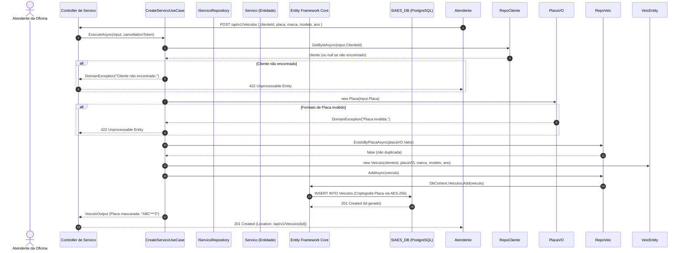

# Diagrama de Componentes (C3 do Modelo C4) — Serviço

Este documento descreve a arquitetura do subsistema de **Serviço** no sistema **SIAES**, apresentando o **Diagrama de Componentes (C3 do modelo C4)** que detalha as camadas de software da API Backend, a organização do casos de uso, as regras do domínio e a persistência.

O modelo segue fielmente a estrutura e a representação de camadas definida no arquivo [`C4_Servicos_Component_C3.drawio`](drawio/C4_Servicos_Component_C3.drawio).

---

## 1. Visão Geral (Nível C3)

No modelo C4, o diagrama **C3 (Component)** detalha a organização interna do contêiner **`SIAES.API` (.NET 10 / ASP.NET Core)** para o módulo de **Serviço**:
- **Apresentação (`SIAES.API`)**: Controladores REST que recebem as requisições HTTP, executam autenticação JWT e delegam a execução.
- **Camada Aplicação (`Application`)**: Casos de uso especializados que orquestram validações, consultas e comandos de escrita.
- **Camada Domínio (`Domain`)**: Entidade rica (`Servico`).
- **Camada Infraestrutura (`Infrastructure`)**: Repositórios de persistência, mapeamentos ORM com o Entity Framework Core.
- **Banco de Dados (`SIAES_DB`)**: Armazenamento relacional PostgreSQL 16 com integridade referencial estrita e índices únicos B-Tree.

---

## 2. Diagrama C3 — Componente de Servico

```mermaid
flowchart TD
    %% Ator / Consumidor
    Usuario["Administrador da Oficina\n[Persons]\Administradores"]:::person

    %% Fronteira do Sistema SIAES (API Backend)
    subgraph SIAESBoundary ["SIAES [API Backend — ASP.NET Core]"]
        
        %% Camada de Apresentação
        subgraph CamadaApresentacao ["Camada Apresentação"]
            ControllerServico["Controller de Serviços\n[Servicos]\nRecebe requisições HTTP e\nencaminha as operações."]:::component
        end

        %% Camada Aplicação
        subgraph CamadaAplicacao ["Camada Aplicação [Container]"]
            CasosUsoServico["Casos de Uso\n[Servico]\nOrquestra as operações de\ngestão dos tipos de serviços oferecidos."]:::component
        end

        %% Camada Domínio
        subgraph CamadaDominio ["Camada Domínio [Container]"]
            DominioServico["Domínio\n[Servico]\nRepresenta as regras e os\nconceitos dos tipos de serviços oferecidos."]:::component
        end

        %% Camada Infraestrutura
        subgraph CamadaInfra ["Camada Infraestrutura [Container]"]
            PersistenciaServico["Persistência\n[Servico]\nImplementa o acesso e a\npersistência dos tipos de serviços oferecidos."]:::component
            EFCore["Entity Framework Core\n[Entity Framework]\nMapeamento objeto-relacional (ORM)\ne conversões de criptografia LGPD"]:::component
        end

    end

    %% Banco de Dados Externo
    DB[("SIAES_DB\n[Container: PostgreSQL 16]\nBanco de dados relacional do sistema SIAES\nTabelas Serviços com índices únicos")]:::db

    %% Relações e Fluxo (exatamente conforme o modelo C3)
    Usuario -->|"HTTP / REST\n(JSON, Bearer Token)"| ControllerServico

    ControllerServico -->|"Invoca operações"| CasosUsoServico

    CasosUsoServico -->|"Executa regras de negócio"| DominioServico

    DominioServico -->|"Persistência via Portas"| PersistenciaServico

    PersistenciaServico -->|"Operações de dados"| EFCore

    EFCore -->|"SQL / TCP 5432"| DB

    %% Estilos visuais C4 (alinhados ao Draw.io)
    classDef person fill:#083F75,stroke:#06315C,color:#ffffff;
    classDef component fill:#1061B0,stroke:#0D5091,color:#ffffff;
    classDef db fill:#23A2D9,stroke:#0E7DAD,color:#ffffff;
```

---

## 3. Catálogo Detalhado de Componentes

### 3.1. Camada de Apresentação (`src/SIAES.API`)

| Componente | Tipo / Arquivo | Responsabilidade |
| :--- | :--- | :--- |
| **`Controller de Serviços`** | [`ServicosController.cs`](file:///home/marcoswferreira/repos/tech-challenge/src/SIAES.API/Controllers/v1/ServicosController.cs) | Endpoints REST `/api/v1/Servicos` para cadastro, consulta por ID, listagem paginada, atualização cadastral e remoção lógica (soft delete). |

### 3.2. Camada de Aplicação (`src/Application`)

| Componente | Casos de Uso Implementados | Responsabilidade |
| :--- | :--- | :--- |
| **`Casos de Uso [Servico]`** | • `CreateServicoUseCase` • `GetServicoByIdUserCase` • `GetServicoPagedUseCase` • `UpdateServicoUseCase` • `DeleteServicoUseCase`   coordenação de transações e transformação de entidades em DTOs mascarados. |

### 3.3. Camada de Domínio (`src/Domain`)

| Componente | Elementos e Value Objects | Responsabilidade |
| :--- | :--- | :--- |
| **`Domínio [Servico]`** | Entidade [`Servico.cs`](file:///home/marcoswferreira/repos/tech-challenge/src/Domain/Entities/Servico.cs) Porta [`IServicoRepository.cs`](file:///home/marcoswferreira/repos/tech-challenge/src/Domain/Repositories/IServicoRepository.cs) | 

### 3.4. Camada de Infraestrutura (`src/Infrastructure`)

| Componente | Tipo / Arquivo | Responsabilidade |
| :--- | :--- | :--- |
| **`Persistência [Servico]`** | [`ServicoRepository.cs`](file:///home/marcoswferreira/repos/tech-challenge/src/Infrastructure/Repositories/ServicoRepository.cs) | Implementação concreta de `IServicoRepository` com consultas otimizadas, filtros de exclusão lógica (`IsActive`). |

| **`Entity Framework Core`** | [`ApplicationDbContext.cs`](file:///home/marcoswferreira/repos/tech-challenge/src/Infrastructure/Database/ApplicationDbContext.cs) [`DeterministicEncryption.cs`](file:///home/marcoswferreira/repos/tech-challenge/src/Infrastructure/Security/DeterministicEncryption.cs) | ORM configurado com migrações. |

---

## 4. Diagramas de Sequência

### 4.1. Cadastro de Serviço

---

## 5. Arquivo Draw.io Nativo

O diagrama original editável está disponível em:
- 📁 [`docs/architecture/drawio/C4_ClientesVeiculos_Component_C3.drawio`](drawio/C4_ClientesVeiculos_Component_C3.drawio)
