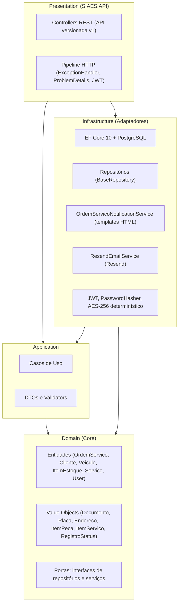
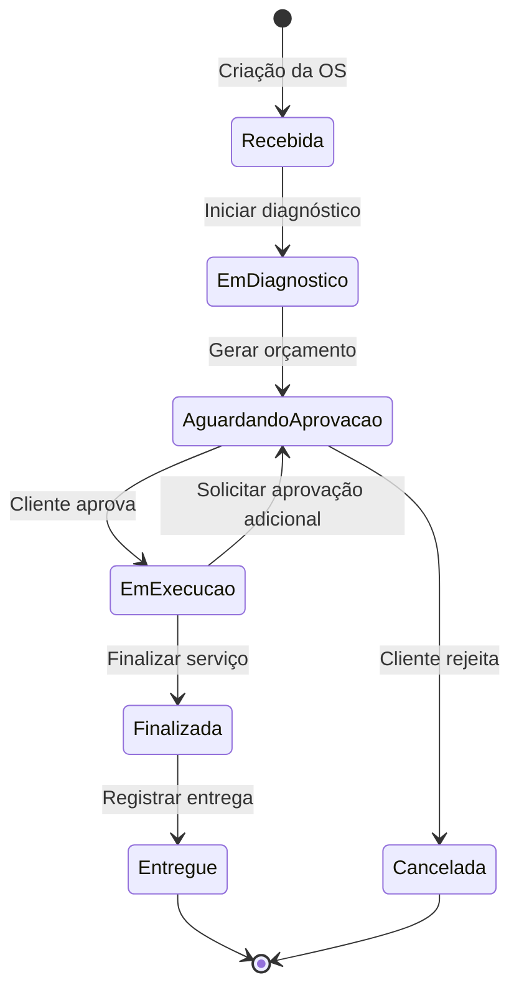

# Arquitetura e Estrutura da Solução (SIAES)

Este documento descreve as decisões arquiteturais e a organização física e lógica da solução **SIAES**. Ele deve permanecer consistente com o [`README.md`](../../README.md) e com a [Linguagem Ubíqua](linguagem-ubiqua.md): qualquer termo, regra ou fluxo citado aqui usa o mesmo vocabulário e reflete o comportamento atual do código.

---

## 1. Padrão Arquitetural

A solução segue os princípios da **Clean Architecture** (*Ports and Adapters*) combinados com **Domain-Driven Design (DDD)**. O objetivo é manter as regras de negócio no centro do sistema, isoladas de banco de dados, provedores externos e da camada HTTP, facilitando manutenção e testabilidade.

### 1.1. Regra de dependência (conforme os `.csproj`)

| Projeto | Referencia projetos | Observação |
| :--- | :--- | :--- |
| `Domain` | nenhum | **100% puro**: zero dependências de pacotes externos ou ORM (sem dependência de EF Core). Contém apenas regras de negócio, entidades, VOs e portas. |
| `Application` | `Domain` | Conhece apenas as **portas** do Domain. |
| `Infrastructure` | `Domain`, `Application` | Implementa as portas (repositórios, e-mail, notificações, token, hash de senha). |
| `SIAES.API` | `Application`, `Infrastructure` | Composition root: registra os casos de uso e os adaptadores na injeção de dependência. |

---

## 2. Camadas

### 2.1. Domain (`src/Domain`)

Núcleo das regras de negócio. Não referencia outros projetos da solução.

- **Entidades** (`Entities/`): `OrdemServico`, `Cliente`, `Veiculo`, `ItemEstoque`, `Servico`, `User`, `UserRole`, `RegistroStatus`.
  - Raízes de agregado marcadas com `IAggregateRoot`: `Cliente` e `ItemEstoque`. `OrdemServico` é o agregado central do fluxo de atendimento e encapsula suas coleções (`Servicos`, `Pecas`, `Historico`) como somente leitura.
- **Value Objects** (`ValueObjects/`): imutáveis e com validação no construtor.
  - `Documento`: CPF ou CNPJ com validação de dígitos verificadores; expõe `Formatado` e `Mascarado` (LGPD).
  - `Placa`: padrão antigo (`ABC-1234`) e Mercosul (`ABC1D23`); expõe `Formatado` e `Mascarada`.
  - `Endereco`, `ItemServico` (serviço executado na OS), `ItemPeca` (peça consumida da OS, vinculada a um `ItemEstoque`).
- **Enums** (`Enums/`): `StatusOrdemServico`, `UnidadeMedida` (`Unidade`, `Litro`, `Quilo`), `TipoDocumento` (`CPF`, `CNPJ`).
- **Constantes** (`Constants/Roles.cs`): `Admin`, `Manager`, `Operacional`, `User`.
- **Portas** (`Interfaces/`):
  - Repositórios: `IBaseRepository<T>`, `IOrdemServicoRepository`, `IClienteRepository`, `IVeiculoRepository`, `IItemEstoqueRepository`, `IServicoRepository`, `IUserRepository`.
  - Serviços: `IOrdemServicoNotificationService`, `IResendEmailService`, `ITokenService`, `IPasswordHasher`, `IUserContext`.
- **Exceções de domínio**: `DomainException` e `TransicaoInvalidaException` (transição de status não permitida).
- **Base** (`Common/Entities`): `BaseEntity`, `AuditableBaseEntity` (quem/quando criou e alterou) e `SoftDeleteBaseEntity` (exclusão lógica).

### 2.2. Application (`src/Application`)

Orquestra os fluxos de negócio por meio de **casos de uso** (uma classe por operação), DTOs de entrada/saída e validadores. Não conhece EF Core, Resend nem HTTP.

| Módulo | Casos de uso |
| :--- | :--- |
| `Auth` | `AuthenticateUserUseCase`, `RefreshTokenUseCase`, `RevokeTokenUseCase` |
| `Users` | `CreateUserUseCase`, `GetUserByIdUseCase`, `GetUsersPagedUseCase`, `UpdateUserUseCase`, `DeleteUserUseCase`, `ChangePasswordUseCase` |
| `Clientes` | `CreateClienteUseCase`, `GetClienteByIdUseCase`, `GetClientesPagedUseCase`, `UpdateClienteUseCase`, `DeleteClienteUseCase` |
| `Veiculos` | `CreateVeiculoUseCase`, `GetVeiculoByIdUseCase`, `GetVeiculosPagedUseCase`, `UpdateVeiculoUseCase`, `DeleteVeiculoUseCase` |
| `ItensEstoque` | `CreateItemEstoqueUseCase`, `GetItemEstoqueByIdUseCase`, `GetItensEstoquePagedUseCase`, `UpdateItemEstoqueUseCase`, `DeleteItemEstoqueUseCase`, `RegistrarEntradaEstoqueUseCase` |
| `Servicos` | `CreateServicoUserCase`, `GetServicoByIdUserCase`, `GetServicoPagedUseCase`, `UpdateServicoUserCase`, `DeleteServicoUserCase` |
| `OrdensServico` | `CreateOrdemServicoUseCase`, `GetOrdemServicoByIdUseCase`, `GetOrdensServicoPagedUseCase`, `GetStatusOrdemServicoUseCase`, `IniciarDiagnosticoUseCase`, `AdicionarPecaOrdemServicoUseCase`, `AdicionarServicoOrdemServicoUseCase`, `GerarOrcamentoUseCase`, `SolicitarAprovacaoAdicionalUseCase`, `AprovarOrcamentoUseCase`, `RejeitarOrcamentoUseCase`, `FinalizarOrdemServicoUseCase`, `EntregarVeiculoUseCase` |

### 2.3. Infrastructure (`src/Infrastructure`)

Implementa as portas definidas no Domain.

- **Persistência** (`Database/`): `ApplicationDbContext`, mapeamentos fluentes (`Mapping/`), migrações, `BaseRepository<T>` e repositórios específicos, e `DatabaseSeeder`.
- **Notificações e e-mail** (`Services/`): `OrdemServicoNotificationService` (monta o HTML e decide o destinatário) e `ResendEmailService` (envio via Resend). A divisão mantém o provedor substituível: trocar o Resend afeta apenas `ResendEmailService`.
- **Segurança** (`Security/`, `Services/TokenService.cs`): emissão de JWT, `PasswordHasher`, `DeterministicEncryption` e `UserContext` (usuário corrente para auditoria).
- **Configuração** (`Extensions/`, `Settings/`): registro de dependências e opções tipadas (`JwtSettings`, `EncryptionSettings`, `ResendSettings`).

### 2.4. API / Presentation (`src/SIAES.API`)

Ponto de entrada HTTP. Contém os controllers (`api/v1/...`), versionamento de API, Swagger/OpenAPI, autenticação JWT e o tratamento global de erros (`ExceptionHandler` + `ProblemDetails` com `requestId` e `traceId`).

---

## 3. Fluxo da Ordem de Serviço

A `OrdemServico` implementa uma máquina de estados: qualquer transição fora da tabela abaixo lança `TransicaoInvalidaException`.

| Endpoint (`POST /api/v1/ordens-servico`) | Caso de uso | Efeito no Domain | Efeito colateral |
| :--- | :--- | :--- | :--- |
| `/` | `CreateOrdemServicoUseCase` | OS criada em `Recebida` | E-mail "Veículo Recebido" |
| `/{id}/diagnostico` | `IniciarDiagnosticoUseCase` | `EmDiagnostico` | — |
| `/{id}/pecas` | `AdicionarPecaOrdemServicoUseCase` | Adiciona `ItemPeca` e recalcula `ValorTotal` | `ItemEstoque.Reservar()` |
| `/{id}/servicos` | `AdicionarServicoOrdemServicoUseCase` | Adiciona `ItemServico` e recalcula `ValorTotal` | — |
| `/{id}/orcamento` | `GerarOrcamentoUseCase` | `AguardandoAprovacao` (exige `ValorTotal > 0`) | E-mail "Orçamento Disponível para Aprovação" |
| `/{id}/solicitar-aprovacao-adicional` | `SolicitarAprovacaoAdicionalUseCase` | `AguardandoAprovacao` (a partir de `EmExecucao`) | E-mail "Orçamento Disponível para Aprovação" (com itens adicionais) |
| `/{id}/aprovar` | `AprovarOrcamentoUseCase` | `EmExecucao` | E-mail "Orçamento Aprovado" |
| `/{id}/rejeitar` | `RejeitarOrcamentoUseCase` | `Cancelada` | `ItemEstoque.LiberarReserva()` + e-mail "Orçamento Rejeitado" |
| `/{id}/finalizar` | `FinalizarOrdemServicoUseCase` | `Finalizada` | `ItemEstoque.BaixarReserva()` + e-mail "Veículo Pronto para Retirada" |
| `/{id}/entregar` | `EntregarVeiculoUseCase` | `Entregue` | E-mail "Veículo Entregue" |

Cada mudança de status gera um `RegistroStatus` (status anterior, novo status e data/hora UTC), formando o histórico da OS.

### 3.1. Estoque: reserva, liberação e baixa

`ItemEstoque` controla `QuantidadeEmEstoque` e `QuantidadeReservada`; `QuantidadeDisponivel = QuantidadeEmEstoque − QuantidadeReservada`.

- `Reservar(q)`: falha se `q` for maior que o saldo disponível.
- `LiberarReserva(q)`: devolve a reserva ao saldo disponível (orçamento rejeitado).
- `BaixarReserva(q)`: reduz reserva **e** estoque físico (serviço finalizado).
- Itens em `Unidade` só aceitam quantidades inteiras; `Litro` e `Quilo` aceitam frações.
- A coluna `Versao` é mapeada como *row version* (`xmin` do PostgreSQL), que dá concorrência otimista e evita que duas OS reservem o mesmo saldo simultaneamente.

### 3.2. Notificações por e-mail

- Os casos de uso dependem apenas de `IOrdemServicoNotificationService` (porta no Domain).
- A notificação é disparada **após** o `SaveChanges`. O envio é aguardado dentro da requisição (não há fila nem processamento em segundo plano).
- Cliente sem e-mail cadastrado: a notificação é ignorada e registrada em log informativo.
- Falha do provedor: capturada e registrada em log de erro; **não** interrompe nem desfaz a operação de negócio já persistida.

### 3.3. Consulta pública de status

`GetStatusOrdemServicoUseCase` atende `GET /api/v1/ordens-servico/{id}/status` e `GET /api/v1/ordens-servico/documento/{documento}/status`, permitindo ao cliente acompanhar a OS sem credenciais.

---

## 4. Persistência

- **Banco**: PostgreSQL 16 via EF Core 10 (justificativa na [ADR 001](../adrs/adr-001-escolha-do-banco-de-dados.md)).
- **Mapeamento da OS**: `ItemServico` e `ItemPeca` são *owned types* persistidos em `OrdensServico_Servicos` e `OrdensServico_Pecas`; o histórico fica em `RegistroStatus`.
- **Consultas**: `GetByIdWithDetailsAsync` usa `AsSplitQuery()` para evitar explosão cartesiana ao carregar várias coleções.
- **Exclusão lógica**: entidades com `SoftDeleteBaseEntity` recebem filtro global de consulta (`IsDeleted == false`).
- **Auditoria**: `AuditableBaseEntity` registra autor e data de criação/alteração a partir do `IUserContext`.
- **Migrações e carga inicial**: `MigrateDatabaseAsync` e o `DatabaseSeeder` (usuários, clientes, veículos, itens de estoque e serviços padrão) executam na inicialização **somente em ambiente `Development`** (ver `Program.cs`). O `docker-compose.override.yml` define `ASPNETCORE_ENVIRONMENT=Development`, por isso `docker-compose up` já sobe o banco migrado e populado; usando apenas o `docker-compose.yml` base, esse passo não ocorre.

---

## 5. Segurança

- **Autenticação**: JWT com *access token* de 15 minutos e *refresh token* de 7 dias. O refresh token trafega em cookie `HttpOnly` (com *fallback* pelo corpo da requisição).
- **Senhas**: `PasswordHasher` do ASP.NET Core Identity (PBKDF2 com salt).
- **Dados sensíveis (LGPD)**: `Documento` (Cliente) e `Placa` (Veiculo) são gravados criptografados com **AES-256 determinístico** (`DeterministicEncryption`), o que permite busca por igualdade e índice único. A chave vem de `EncryptionSettings`. Nas respostas, os VOs oferecem versões mascaradas.
- **Perfis (`Roles`)**: `Admin`, `Manager`, `Operacional`, `User`.

| Recurso | Regra de acesso atual |
| :--- | :--- |
| `Auth` (login, refresh-token, logout) | Anônimo |
| `Users` | `POST` anônimo (autocadastro restrito ao perfil `User`); listar e excluir: `Admin`; consultar por id, alterar e trocar senha: autenticado |
| `Clientes` e `Veiculos` | Autenticado; excluir: `Admin` |
| `ItensEstoque` | Leitura: autenticado; criar, alterar e registrar entrada: `Admin`, `Manager`, `Operacional`; excluir: `Admin`, `Manager` |
| `Servicos` | Qualquer usuário autenticado |
| `OrdensServico` | Consultas de status: anônimo; demais operações: `Admin`, `Manager`, `Operacional` |

---

## 6. Tecnologias Utilizadas

- **Linguagem / plataforma**: C# / .NET 10
- **Web**: ASP.NET Core Web API com versionamento (`Asp.Versioning`) e Swagger (Swashbuckle)
- **Persistência**: Entity Framework Core 10 + Npgsql (PostgreSQL 16)
- **E-mail transacional**: Resend (.NET SDK)
- **Autenticação**: JWT Bearer
- **Testes**: xUnit, NSubstitute e Coverlet
- **Qualidade e CI**: GitHub Actions e SonarCloud
- **Contêineres**: Docker e Docker Compose

---

## 7. Estrutura de Testes

Os testes ficam em `tests/` e totalizam **406 testes, todos passando** (`dotnet test SIAES.slnx`):

| Projeto | Testes | Escopo |
| :--- | :--- | :--- |
| `Domain.UnitTests` | 186 | Entidades, Value Objects e regras de domínio |
| `Application.UnitTests` | 121 | Casos de uso, com repositórios e serviços simulados (NSubstitute) |
| `IntegrationTests` | 99 | Testes ponta a ponta com `WebApplicationFactory` cobrindo **98,6% de cobertura de código em todos os controllers** (`OrdensServico`, `Auth`, `Clientes`, `Veiculos`, `ItensEstoque`, `Servicos`, `Users`), além de testes de segurança/autorização, criptografia determinística LGPD, arquitetura limpa (NetArchTest) e notificações |

Padrão adotado: **Arrange / Act / Assert**, com test doubles in-memory e NSubstitute para dependências externas. Nenhum teste faz chamada real externa.

No SonarCloud, os diretórios `Infrastructure` e `SIAES.API` (além de migrações, mapeamentos, seeders e extensões) são excluídos da métrica de cobertura (`sonar.coverage.exclusions` em `.github/workflows/ci.yml`).

---

## 8. Roadmap Técnico

**Concluído**

- [x] Tratamento global de erros (`ExceptionHandler` + `ProblemDetails`).
- [x] Pipeline de CI (build, testes, SonarCloud e validação do build Docker).
- [x] Autenticação JWT com *refresh token* e perfis por `Roles`.
- [x] Ciclo de vida completo da OS integrado ao estoque e às notificações por e-mail.
- [x] Proteção dos endpoints de `OrdensServico` (`[Authorize(Roles = Admin, Manager, Operacional)]`), mantendo anônimas apenas as consultas públicas de status.
- [x] Restrição de `POST /api/v1/Users` (anônimo): remoção do campo `Roles` do payload de autocadastro (`CreateUserInput`), atribuindo sempre o perfil `User` por padrão e impedindo escalação de privilégios.
- [x] Domain sem dependência de EF Core: helpers de paginação movidos para `Infrastructure` e assinatura de `IBaseRepository` purificada; `Domain.csproj` 100% puro sem dependências externas de pacotes.
- [x] Aprovação adicional da OS: caso de uso `SolicitarAprovacaoAdicionalUseCase` e endpoint `POST /api/v1/ordens-servico/{id}/solicitar-aprovacao-adicional` para reenvio de orçamentos adicionais em execução.

**Pendências e débitos conhecidos**

- [ ] **Tempo médio de execução dos serviços** (requisito do desafio): o histórico `RegistroStatus` já guarda os timestamps necessários, mas não há caso de uso nem endpoint.
- [ ] **Eventos de domínio**: `IDomainEvent` existe, mas não é usado; as notificações são chamadas diretamente pelos casos de uso (e de forma síncrona). Avaliar eventos + processamento assíncrono.
- [ ] **Observabilidade**: logs estruturados e *tracing* centralizados.
